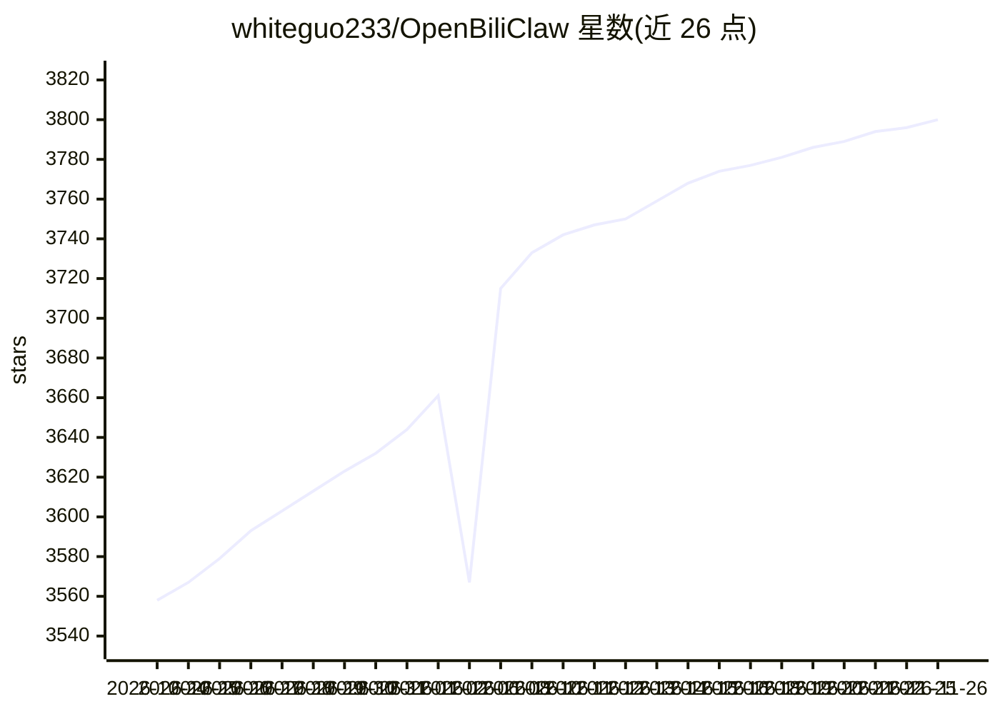

# whiteguo233/OpenBiliClaw

⭐ 3,800 · Python · MIT · 推送 2026-11-25 · [GitHub](https://github.com/whiteguo233/OpenBiliClaw) · [官网](https://whiteguo233.github.io/OpenBiliClaw/) · 个人维护 · 中文 README

**本地运行的个性化跨平台内容发现 Agent**

在本地运行的个性化内容发现 Agent：从浏览器行为、反馈与对话中沉淀五层画像，主动在 B 站、小红书、抖音、YouTube、X、知乎、Reddit、微博等 14 个平台及自定义网站/RSS 中寻找内容并生成推荐理由。入口包括浏览器插件、桌面/移动 Web、Flutter 原生 App 与 DSH 插件；画像与历史存于本地 SQLite。后端提供桌面安装包、Shell 脚本、Docker Compose 与源码多种部署路径，Python 3.11+。

## 筛选速览

| 维度 | 判定 | 备注 |
|---|---|---|
| AI 角色 | `ai-native` | 本体是模型或模型工具 |
| 许可风险 | `permissive` | MIT |
| 部署形态 | `desktop` | 安装包/桌面程序 |
| 模型依赖 | local-ok | 支持本地模型 |
| 硬件要求 | — | 无带数字的原话,不猜 |
| 安装摩擦 | `low` | 无编译、无系统依赖或容器化 |
| 成熟度 | — | 结构信号不足 |

## 能力要点

- 14 个内置内容平台 + 聊天一句话订阅任意网站/RSS
- 五层心理画像与兴趣/避雷探针，四态确认后写入长期偏好
- 画像、历史与候选池默认存本地 SQLite，无云端账号体系
- Agent Bridge（agent-bridge/v2）与 DSH 插件，注册 22 个工具供宿主 Agent 调用

## 适用场景

- 把分散在多个平台的浏览线索汇总为一份个人画像与跨平台推荐
- 在本地管理收藏、稍后看与 30 天历史并写回部分平台
- 通过 OpenClaw/Claude Code 等宿主 Agent 点播或接收主动内容推送

## 场景标签

`推荐系统` · 领域:学习与行业

## 证据(README 行号)

> L46: 一个纯本地、私有、开源的自进化跨平台内容发现 Agent。它从你的跨平台行为、反馈和对话中持续深化五层心理画像，带着对你的理解主动去 **B 站、小红书、抖音、YouTube、TikTok、X、知乎、Reddit、Linux.do
> L178: - 🆓 **预置免费模型 & 本地向量** — 开箱内置硅基流动免费 LLM（Qwen3-8B / Qwen3.5-4B）与云端 BGE-M3，也支持 Ollama 本地 `bge-m3` 或任意 OpenAI / Anthro
> L3: **通用个性化内容推荐 Agent——本地运行、跨平台理解你、只为你一个人构建**

## 星数曲线

2026-10-24 3,558 → 2026-11-26 3,800（+242）

---
*卡片 v1 · prompt 1.4 · 生成 2026-11-26 · 置信度 high · 依据 README sha `61e868cf8e65` · [字段定义](../../DATASET.md)*
