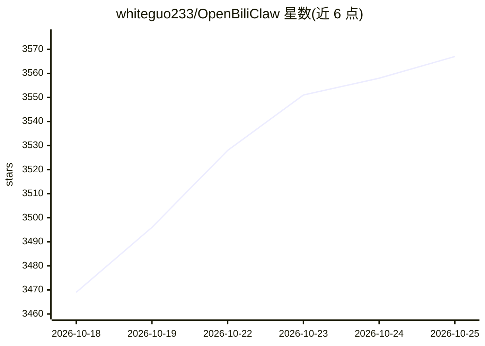

# whiteguo233/OpenBiliClaw

⭐ 3,567 · Python · MIT · 推送 2026-10-24 · [GitHub](https://github.com/whiteguo233/OpenBiliClaw) · [官网](https://whiteguo233.github.io/OpenBiliClaw/) · 个人维护 · 中文 README

**本地运行的跨平台个性化 AI 内容发现 Agent**

纯本地、开源的内容推荐 Agent：从用户跨平台使用行为、反馈与对话中构建五层心理画像，再主动从 B站、小红书、抖音、YouTube、TikTok、X、知乎、Reddit、微博等 15+ 平台与开放 Web 搜寻内容。数据默认存本机 SQLite，LLM 使用用户自己的 API Key。形态为浏览器插件（Chrome/Edge/Firefox/Safari）+ 桌面后端安装包（macOS/Windows），另有独立 Flutter 移动客户端与 DeepSeek Harness 插件。Instagram 与 TikTok 来源为实验性、默认关闭，桌面应用为预发布版本。

## 筛选速览

| 维度 | 判定 | 备注 |
|---|---|---|
| AI 角色 | `ai-native` | 本体是模型或模型工具 |
| 许可风险 | `permissive` | MIT |
| 部署形态 | `desktop` | 安装包/桌面程序 |
| 模型依赖 | local-ok | 支持本地模型 |
| 硬件要求 | — | 无带数字的原话,不猜 |
| 安装摩擦 | `low` | 无编译、无系统依赖或容器化 |
| 成熟度 | `idea` | |

## 能力要点

- 跨 15+ 平台（B站/小红书/抖音/YouTube/TikTok/X/知乎/Reddit/微博/GitHub 等）主动内容发现
- 五层画像（事件→偏好→觉察→洞察→灵魂）与 MBTI/认知风格推断
- 数据 100% 存本机 SQLite，LLM 用用户自有 API Key
- 支持喜欢/不感兴趣/对话反馈改变后续推荐
- 提供 DeepSeek Harness 客户端插件（22 个 Agent Bridge 工具）

## 适用场景

- 把分散在各平台的兴趣数据合并到本地的个性化推荐
- 通过对话和反馈调教只属于自己的推荐 Agent
- 让 AI 基于画像主动探索自己未接触过的兴趣领域
- 手机或 DSH 界面中远程访问本地推荐内容

## 场景标签

`推荐系统` · 领域:学习与行业

## 证据(README 行号)

> L39: 一个纯本地、私有、开源的自进化跨平台内容发现 Agent：从你的跨平台使用、反馈和对话中持续深化心理画像，带着对你的理解主动去 B 站、小红书、抖音、YouTube、TikTok、X、知乎、Reddit、Linux.do、Bang
> L105: **OpenBiliClaw 反过来。** 它是一个本地运行的 AI Agent——先深度理解你，再根据对你的理解**跨平台**主动搜寻你会喜欢的内容。项目从 B 站起步，现已覆盖小红书、抖音、YouTube、TikTok、X（
> L117: 核心行为、推荐和对话数据留在你硬盘上的 SQLite，配置、画像、凭据与缓存也只保存在本机文件中。LLM 默认用你自己的 API Key，也可实验性复用本机 Codex CLI 的 ChatGPT OAuth 凭据。没有 Ope

## 星数曲线

2026-10-18 3,469 → 2026-10-25 3,567（+98）

---
*卡片 v1 · prompt 1.4 · 生成 2026-10-20 · 置信度 mid · 依据 README sha `c237e77ab4c5` · [字段定义](../../DATASET.md)*
