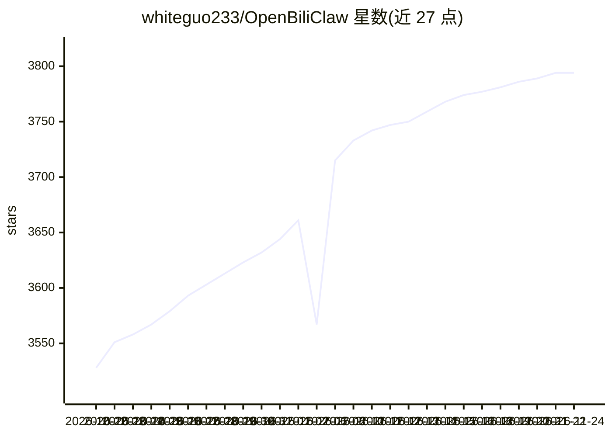

# whiteguo233/OpenBiliClaw

⭐ 3,796 · Python · MIT · 推送 2026-11-23 · [GitHub](https://github.com/whiteguo233/OpenBiliClaw) · [官网](https://whiteguo233.github.io/OpenBiliClaw/) · 个人维护 · 中文 README

**本地运行的跨平台 AI 内容发现 Agent，为个人构建个性化推荐**

本地优先的开源内容发现 Agent：通过浏览器插件采集 B 站、小红书、抖音、YouTube、X 等 14 个平台与自定义网站/RSS 的行为信号，在本地 SQLite 中沉淀五层心理画像（事件→偏好→觉察→洞察→灵魂），再带画像主动跨平台寻找内容并给出推荐理由。提供桌面安装包、Shell/PowerShell 脚本、Docker Compose 与源码四种部署路径，入口包括浏览器插件、桌面/移动 Web 与独立 Flutter App，支持对话调教画像与兴趣探针确认机制。

## 筛选速览

| 维度 | 判定 | 备注 |
|---|---|---|
| AI 角色 | `ai-native` | 本体是模型或模型工具 |
| 许可风险 | `permissive` | MIT |
| 部署形态 | `desktop` | 安装包/桌面程序 |
| 模型依赖 | local-ok | 支持本地模型 |
| 硬件要求 | — | 无带数字的原话,不猜 |
| 安装摩擦 | `low` | 无编译、无系统依赖或容器化 |
| 成熟度 | — | 结构信号不足 |

## 能力要点

- 14 个内置平台加自定义网站/RSS 的跨平台内容发现
- 五层心理画像与 MBTI/认知风格推断，行为数据留在本地 SQLite
- 预置硅基流动免费模型（Qwen3-8B/Qwen3.5-4B），也支持 Ollama 或 OpenAI/Anthropic/Gemini/DeepSeek 实例
- 提供 Chrome/Firefox/Safari 插件、桌面与移动 Web、Flutter App、DSH 插件多个入口

## 适用场景

- 把分散在多个平台的浏览线索汇聚成一份个人画像并跨平台获取推荐
- 通过聊天或反馈持续调教推荐口味，主动探索平台外的新兴趣
- 在本地保留浏览、收藏与画像数据，不依赖云端账号体系

## 场景标签

`推荐系统` · 领域:学习与行业

## 证据(README 行号)

> L46: 一个纯本地、私有、开源的自进化跨平台内容发现 Agent。它从你的跨平台行为、反馈和对话中持续深化五层心理画像，带着对你的理解主动去 **B 站、小红书、抖音、YouTube、TikTok、X、知乎、Reddit、Linux.do
> L148: - 🧠 **先懂你，再找内容**：通过行为分析沉淀五层灵魂画像（事件 → 偏好 → 觉察 → 洞察 → 灵魂），推断 MBTI、认知风格与深层心理需求。
> L180: - 🆓 **预置免费模型 & 本地向量** — 开箱内置硅基流动免费 LLM（Qwen3-8B / Qwen3.5-4B）与云端 BGE-M3，也支持 Ollama 本地 `bge-m3` 或任意 OpenAI / Anthro

## 星数曲线

2026-10-22 3,528 → 2026-11-24 3,794（+266）

---
*卡片 v1 · prompt 1.4 · 生成 2026-11-23 · 置信度 mid · 依据 README sha `e5717687cd8e` · [字段定义](../../DATASET.md)*
