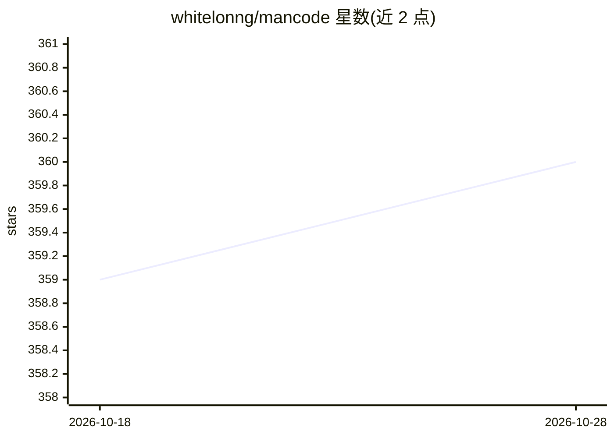

# whitelonng/mancode

⭐ 360 · TypeScript · AGPL-3.0 · 推送 2026-10-25 · [GitHub](https://github.com/whitelonng/mancode) · [官网](https://whitelonng.github.io/mancode/) · 个人维护 · 中文 README

**AI 编码代理的工作流调度框架：约束过度设计、跨会话上下文与脱敏**

mancode 是套在 Claude Code、Cursor、Codex、GitHub Copilot、Kimi Code 等现有 AI 编码代理之上的 CLI 工作流层，非这些代理的替代品。提供 solo、/man、/manba、/manteam、/manps、/mansolo 六种模式，负责任务规划、需求澄清、证据化代码审查、跨会话 Context Pack 与团队共享记忆；内置本机凭据/个人信息识别与脱敏副本生成。通过 npm 全局安装后运行 mancode init 接入各平台，需 Node.js 22.5.0+，AGPL-3.0 许可，Windows 上部分执行门禁不可用。

## 筛选速览

| 维度 | 判定 | 备注 |
|---|---|---|
| AI 角色 | `ai-ecosystem` | LLM/agent 周边工具 |
| 许可风险 | `viral` | AGPL-3.0 |
| 部署形态 | `library` | 以包/库形式分发 |
| 模型依赖 | locked-api |  |
| 硬件要求 | — | 无带数字的原话,不猜 |
| 安装摩擦 | `low` | 无编译、无系统依赖或容器化 |
| 成熟度 | — | 结构信号不足 |

## 能力要点

- 五种以上工作流模式（solo 到 /man 季后赛级治理）
- 跨会话 TaskRef / Context Pack 与团队共享记忆
- 分享前本地脱敏与敏感内容门禁
- 适配 Claude Code、Cursor、Codex、Copilot、Kimi Code 等 9 个平台

## 适用场景

- 约束 AI 编码代理减少过度设计与冗余抽象
- 关键任务走计划、验证、审查的完整流程
- 跨会话或多代理协作时保留决策与验收证据
- 分享日志配置前生成脱敏副本

## 场景标签

`多智能体` `工作流自动化` `代码审查` `Agent 框架` · 领域:Agent 开发

## 证据(README 行号)

> L8:  为 Claude Code、Cursor、ChatGPT 桌面端中的 Codex、Codex CLI、GitHub Copilot、
> L27: **mancode** 是一个 AI 编码代理工作流调度工具。它给 agent 不同强度的工作模式：
> L48: mancode 不是 Claude Code、Cursor、Codex 或 Copilot 的替代品。它是在现有 agent

## 星数曲线

2026-10-18 359 → 2026-10-28 360（+1）

---
*卡片 v1 · prompt 1.4 · 生成 2026-10-22 · 置信度 high · 依据 README sha `7fe9248b796d` · [字段定义](../../DATASET.md)*
