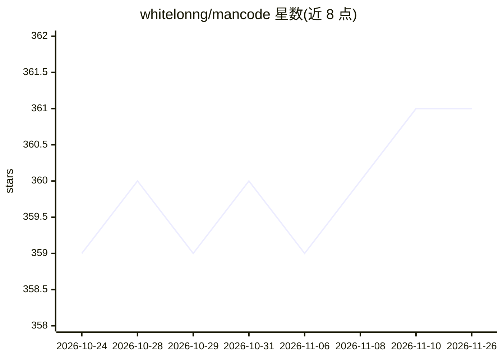

# whitelonng/mancode

⭐ 361 · TypeScript · AGPL-3.0 · 推送 2026-10-25 · [GitHub](https://github.com/whitelonng/mancode) · [官网](https://whitelonng.github.io/mancode/) · 个人维护 · 中文 README

**给 AI 编码代理加工作流约束的调度工具与本地 Continuity CLI**

以 npm CLI 分发的 AI 编码代理工作流调度框架：为 Claude Code、Cursor、Codex、Copilot 等已有编码代理安装工作流入口与平台 bootstrap，提供 solo 到 /man 五种治理模式，覆盖需求澄清、持久计划、证据化代码审查、完成门禁和跨会话任务延续（TaskRef、Context Pack、workflow 记录）。内置本地优先的隐私脱敏，可在分享前生成脱敏副本；/manteam 支持团队共享上下文。声明不是各代理的替代品，而是其上的一层工作流约束；需要 Node.js 22.5.0+。

## 筛选速览

| 维度 | 判定 | 备注 |
|---|---|---|
| AI 角色 | `ai-ecosystem` | LLM/agent 周边工具 |
| 许可风险 | `viral` | AGPL-3.0 |
| 部署形态 | `library` | 以包/库形式分发 |
| 模型依赖 | — | README 未给出锁定关系 |
| 硬件要求 | — | 无带数字的原话,不猜 |
| 安装摩擦 | `low` | 无编译、无系统依赖或容器化 |
| 成熟度 | — | 结构信号不足 |

## 能力要点

- 五种工作流模式（solo//manba//man//manteam//manps）按任务强度调度编码代理
- 跨会话 Continuity 运行时：任务、决策与验证证据延续到后续对话
- 本地隐私检查与数据脱敏，可拦截敏感共享写入
- 证据化代码审查与完成门禁：命令输出、退出码与观察面记录在案

## 适用场景

- 阻止 AI 代理过度设计、重复造已有组件
- 关键改动走需求澄清→持久计划→审查→完成门禁的流程
- 团队共享已确认决策与项目术语，减少多代理语义漂移
- 分享含凭据或客户资料的日志前先做本地脱敏

## 场景标签

`编码 Agent` `代码审查` `Agent 框架` · 领域:Agent 开发

## 证据(README 行号)

> L5:  AI 编码代理工作流调度框架与本地优先 Continuity CLI，内置隐私保护与数据脱敏。默认 Solo + 五种治理模式：
> L27: **mancode** 是一个 AI 编码代理工作流调度工具。它给 agent 不同强度的工作模式：
> L48: mancode 不是 Claude Code、Cursor、Codex 或 Copilot 的替代品。它是在现有 agent

## 星数曲线

2026-10-24 359 → 2026-11-26 361（+2）

---
*卡片 v1 · prompt 1.4 · 生成 2026-11-25 · 置信度 high · 依据 README sha `7ec523c330ba` · [字段定义](../../DATASET.md)*
