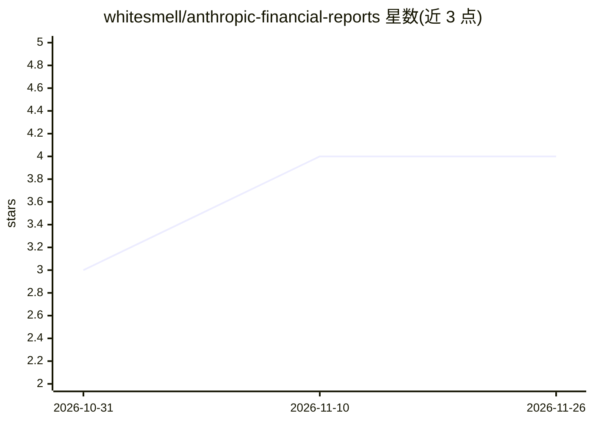

# whitesmell/anthropic-financial-reports

⭐ 4 · 推送 2026-10-28 · [GitHub](https://github.com/whitesmell/anthropic-financial-reports) · 个人维护 · 中文 README

**给 AI 从业者的 Anthropic 招股书与财报中英文阅读资料集**

独立整理的 Anthropic 公开文件中英文阅读项目：收录 2026-10-26 提交的 S-1 招股说明书英文原文 PDF（421 页，400 dpi 阅读副本与 SEC 全文链接）和中文译本 PDF（含术语校订、分级导航与客户案例），后续财报待披露后整理。中文内容为机器翻译加人工校订，尚在持续校对中，项目声明以英文原文与 SEC 文件为权威来源，欢迎提交勘误。

## 筛选速览

| 维度 | 判定 | 备注 |
|---|---|---|
| AI 角色 | `ai-knowledge` | 知识聚合/清单类 |
| 许可风险 | `none` | — |
| 部署形态 | `None` |  |
| 模型依赖 | — | README 未给出锁定关系 |
| 硬件要求 | — | 无带数字的原话,不猜 |
| 安装摩擦 | `low` | 无编译、无系统依赖或容器化 |
| 成熟度 | `idea` | |

## 能力要点

- S-1 中英文 PDF 对照阅读，中文版含术语校订与分级导航
- 链接 SEC 提交记录与原始文件作为权威来源
- 开放翻译勘误与术语建议的贡献流程

## 适用场景

- 阅读 Anthropic 招股书理解其业务、财务与治理结构
- 对照中英译本学习财务与法律术语翻译
- 跟踪 Anthropic 后续公开财报披露

## 场景标签

`教程课程` · 领域:学习与行业

## 证据(README 行号)

> L5: 面向 AI 从业者的 Anthropic 公开文件中英文阅读项目。从 S-1 招股说明书出发，持续整理英文原文、中文译本及后续公开披露的财务报告，帮助读者理解前沿 AI 公司的业务、财务、治理与风险。
> L11: |文件|中文阅读|英文原文|状态|
> L20: - 本项目是独立整理项目，与 Anthropic 及美国证券交易委员会（SEC）无关联，也不是官方译本。

## 星数曲线

2026-10-31 3 → 2026-11-26 4（+1）

---
*卡片 v1 · prompt 1.4 · 生成 2026-11-21 · 置信度 high · 依据 README sha `ffa45d8c3514` · [字段定义](../../DATASET.md)*
