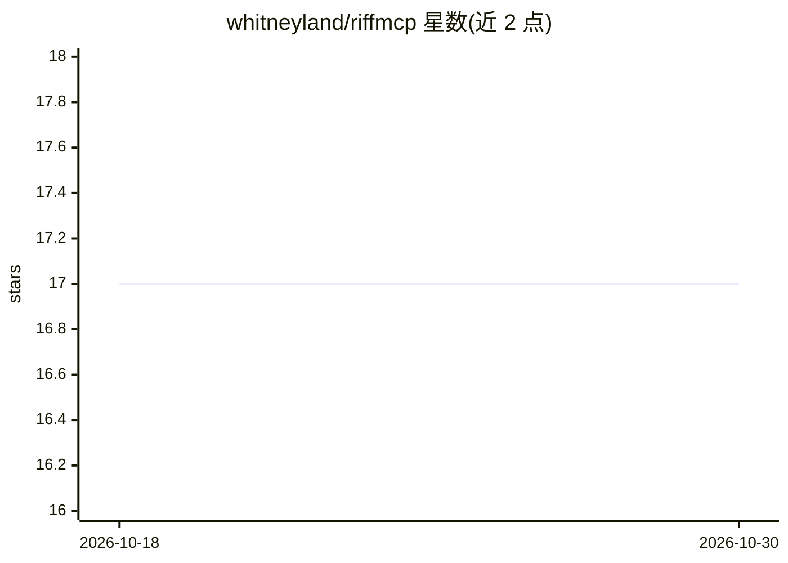

# whitneyland/riffmcp

⭐ 17 · Swift · NOASSERTION · 推送 2025-11-29 · [GitHub](https://github.com/whitneyland/riffmcp) · [官网](https://whitneyland.github.io/riffmcp) · 个人维护

**macOS 原生 MCP 服务器：让 LLM 播放、作曲与渲染乐谱**

以原生 macOS 应用形式运行的本地 MCP 服务器，通过 MCP stdio 协议（内置转发到 HTTP 服务器）向 Claude Desktop、Gemini CLI 等支持 MCP 的 LLM 暴露音乐能力：LLM 与服务器之间使用 JSON 音乐序列格式通信，支持多轨音色播放与基础乐谱渲染，应用内提供 MCP 活动监控、JSON 编辑器与钢琴卷帘界面。安装方式为下载 .dmg 拖入 Applications 后修改 LLM 配置文件；对不支持 MCP 的 LLM 提供提示词模板加手动粘贴 JSON 的替代路径。乐谱渲染基于 Verovio，但三连音、多页输出等特性尚未实现。

## 筛选速览

| 维度 | 判定 | 备注 |
|---|---|---|
| AI 角色 | `ai-ecosystem` | LLM/agent 周边工具 |
| 许可风险 | `none` | NOASSERTION |
| 部署形态 | `desktop` | 安装包/桌面程序 |
| 模型依赖 | locked-api |  |
| 硬件要求 | — | 无带数字的原话,不猜 |
| 安装摩擦 | `low` | 无编译、无系统依赖或容器化 |
| 成熟度 | — | 结构信号不足 |

## 能力要点

- 原生 macOS 应用，单个应用内同时实现 MCP stdio、HTTP 服务器与 GUI，无 Node.js/Electron 依赖
- LLM 与服务器间使用 JSON 音乐序列格式，多轨播放使用 soundfont
- 支持基础乐谱渲染与钢琴卷帘查看播放
- 对不支持 MCP 的 LLM 提供 PROMPT_PIANO/PROMPT_MULTITRACK 提示词模板路径

## 适用场景

- 通过对话让 Claude Desktop 或 Gemini CLI 直接播放、生成音乐
- 让 LLM 生成多轨音乐并查看对应乐谱
- 在应用内调试、编辑 LLM 生成的音乐 JSON 序列

## 场景标签

 · 领域:音乐/MCP 工具

## 证据(README 行号)

> L3: RiffMCP is an MCP server that allows LLMs to play, compose, and render music.
> L16: - Local MCP server that runs as a native macOS app
> L29: - Add RiffMCP to Claude Desktop, Gemini CLI, or any LLM that supports MCP servers (see *Setup* below).

## 星数曲线

2026-10-18 17 → 2026-10-30 17（+0）

---
*卡片 v1 · prompt 1.4 · 生成 2026-10-29 · 置信度 high · 依据 README sha `c8a6fac96a1b` · [字段定义](../../DATASET.md)*
