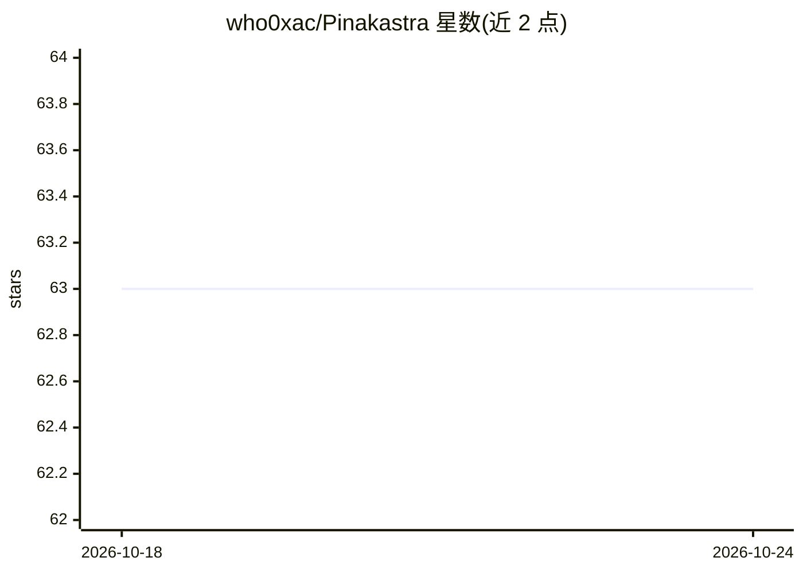

# who0xac/Pinakastra

⭐ 63 · Go · 推送 2025-12-27 · [GitHub](https://github.com/who0xac/Pinakastra) · 个人维护

**面向渗透测试者的 AI 辅助自动化侦察与漏洞利用框架**

Go 编写的渗透测试框架，整合 subfinder、httpx、dnsx、Katana、GAU、Nmap 等外部工具，覆盖子域名发现、存活探测、端口扫描、安全头/云资产/接管检查等侦察流程，并对 XSS、SQLi、SSRF、IDOR、JWT 等漏洞做主动测试。AI 部分：通过本地 Ollama 运行 deepseek-r1:7b 模型（约 6-7GB RAM），为每类漏洞生成 3 条补充 payload、做 Nmap CVE 分析与 NVD 核验。输出 JSON/CSV/TXT 报告。仅限授权测试使用。

## 筛选速览

| 维度 | 判定 | 备注 |
|---|---|---|
| AI 角色 | `ai-enhanced` | 去掉 AI 部分产品仍成立 |
| 许可风险 | `none` | — |
| 部署形态 | `library` | 以包/库形式分发 |
| 模型依赖 | local-ok | 支持本地模型 |
| 硬件要求 | — | 无带数字的原话,不猜 |
| 安装摩擦 | `low` | 无编译、无系统依赖或容器化 |
| 成熟度 | — | 结构信号不足 |

## 能力要点

- 多源子域名发现（8 种被动源 + DNS 爆破）
- 7 类漏洞主动测试：每类 7 条硬编码 payload + 3 条 AI 生成
- 本地 Ollama 运行 deepseek-r1:7b 做自适应 payload 生成与 CVE 分析
- 输出 JSON/CSV/TXT 结构化报告

## 适用场景

- 授权渗透测试中自动化完成侦察到漏洞验证的流程
- Bug bounty 项目里批量发现与测试目标资产
- 本地推理生成绕过型 payload 减少误报

## 场景标签

`网络安全` · 领域:学习与行业

## 证据(README 行号)

> L18: 5. **Scans ports** - Nmap with AI-powered CVE detection
> L49: - **10 payloads per type**: 7 hardcoded advanced + 3 AI-generated bypass
> L54: - Adaptive Payload Generation

## 星数曲线

2026-10-18 63 → 2026-10-24 63（+0）

---
*卡片 v1 · prompt 1.4 · 生成 2026-10-24 · 置信度 mid · 依据 README sha `bac57101a19d` · [字段定义](../../DATASET.md)*
