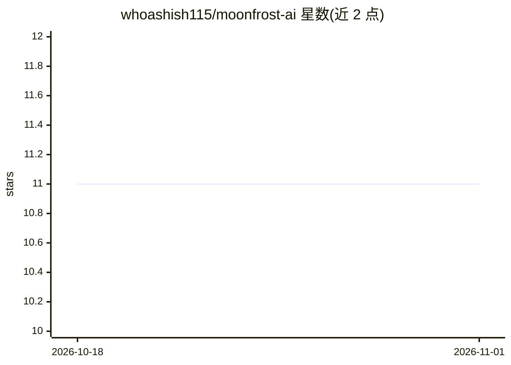

# whoashish115/moonfrost-ai

⭐ 11 · Python · Apache-2.0 · 推送 2026-10-02 · [GitHub](https://github.com/whoashish115/moonfrost-ai) · [官网](https://moonfrost-ai.vercel.app) · 个人维护

**从零训练的 777M 参数 MoE 语言模型及完整训练流水线**

解码器架构语言模型，总参数 777,148,032（每 token 激活 161M），采用 DeepSeek-V2 的多头潜在注意力与 DeepSeekMoE 前馈层（每层 32 专家路由选 3 + 1 共享专家），使用自训 tokenizer。在约 6B FineWeb-Edu token 上预训练、2.7B 指令数据上微调，耗时约 12 H100 小时、成本约 55 美元。仓库含 tokenizer 训练、模型定义、预训练与 SFT 循环、评测工具、云端编排与本地聊天服务器；架构按论文从零实现。限制：模型自信编造事实、无算术/推理/工具使用/检索，仅英文，1,024 token 上下文，自述为小规模训练流水线演示而非可部署助手。

## 筛选速览

| 维度 | 判定 | 备注 |
|---|---|---|
| AI 角色 | `ai-native` | 本体是模型或模型工具 |
| 许可风险 | `permissive` | Apache-2.0 |
| 部署形态 | `library` | 以包/库形式分发 |
| 模型依赖 | — | README 未给出锁定关系 |
| 硬件要求 | — | 无带数字的原话,不猜 |
| 安装摩擦 | `low` | 无编译、无系统依赖或容器化 |
| 成熟度 | — | 结构信号不足 |

## 能力要点

- MLA 注意力 + DeepSeekMoE（3/32 专家路由 + 共享专家）架构，从零实现
- 含 tokenizer 训练、预训练/SFT、评测、云端编排（预算护栏）完整流水线
- 本地聊天服务器：流式回复、检查点切换、无 API key 无遥测
- 52 项模型检查与固定随机种子的复现脚本

## 适用场景

- 学习/复现小规模 MoE 模型的完整训练流程
- 在本地 GPU 上运行并对话体验自训模型
- 对照基准结果研究数据量与参数比的影响

## 场景标签

`模型训练` · 领域:训练与推理

## 证据(README 行号)

> L14: Moonfrost is a decoder-only language model of 777,148,032 parameters, of which 161,036,224
> L23: This repository contains the complete pipeline: tokenizer training, the model definition,

## 星数曲线

2026-10-18 11 → 2026-11-01 11（+0）

---
*卡片 v1 · prompt 1.4 · 生成 2026-11-01 · 置信度 mid · 依据 README sha `3ed6ac10742b` · [字段定义](../../DATASET.md)*
