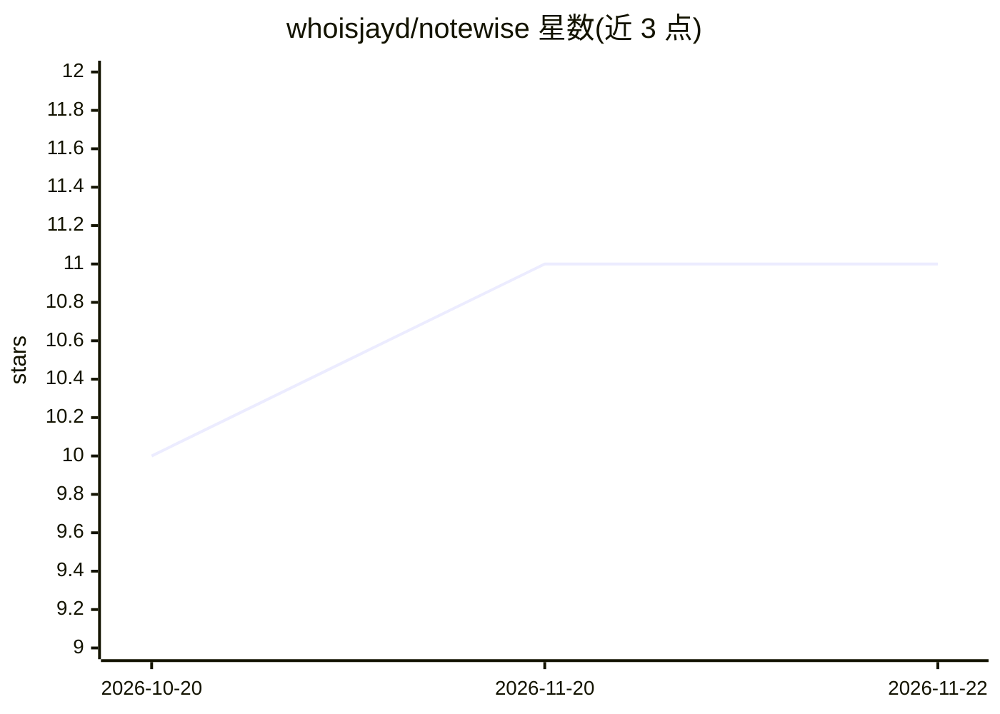

# whoisjayd/notewise

⭐ 11 · Python · NOASSERTION · 推送 2026-11-13 · [GitHub](https://github.com/whoisjayd/notewise) · [官网](https://www.notewise.click/) · 个人维护

**给学习者的终端工具：把 YouTube 视频转成本地学习笔记**

NoteWise 是命令行工具，输入 YouTube 视频或播放列表 URL，生成结构化、分层级的 Markdown 学习笔记，支持按章节拆分文件、长视频分块处理、多语言内容，并可输出 md/docx 格式与测验题。面向学生、开发者、语言学习者、研究人员与团队。通过 uv/uvx/pip/pipx/Docker 或独立二进制安装，运行 notewise setup 后即可使用，笔记默认落在本地 ./output 目录。

## 筛选速览

| 维度 | 判定 | 备注 |
|---|---|---|
| AI 角色 | `ai-native` | 本体是模型或模型工具 |
| 许可风险 | `none` | NOASSERTION |
| 部署形态 | `None` |  |
| 模型依赖 | — | README 未给出锁定关系 |
| 硬件要求 | — | 无带数字的原话,不猜 |
| 安装摩擦 | `low` | 无编译、无系统依赖或容器化 |
| 成熟度 | — | 结构信号不足 |

## 能力要点

- 输入 YouTube 视频/播放列表 URL，生成分层 Markdown 学习笔记
- 章节感知：可按章节拆分为多个文件
- 长视频智能分块处理，支持多语言
- 支持 md/docx 输出格式与 --quiz 测验生成

## 适用场景

- 把课程录像转成可搜索的复习笔记
- 从会议演讲视频中提炼参考资料
- 从外语视频提取结构化学习笔记
- 把团队内部视频演示转成共享文档

## 场景标签

`AI 写作` · 领域:内容生成

## 证据(README 行号)

> L3: **Convert YouTube videos and playlists into local study notes from your terminal.**
> L27: The output is not just a transcript summary. It is structured, hierarchical Markdown with headers, sub-topics, defi
> L32: uv tool install notewise

## 星数曲线

2026-10-20 10 → 2026-11-22 11（+1）

---
*卡片 v1 · prompt 1.4 · 生成 2026-11-19 · 置信度 high · 依据 README sha `f1f5bec1b450` · [字段定义](../../DATASET.md)*
