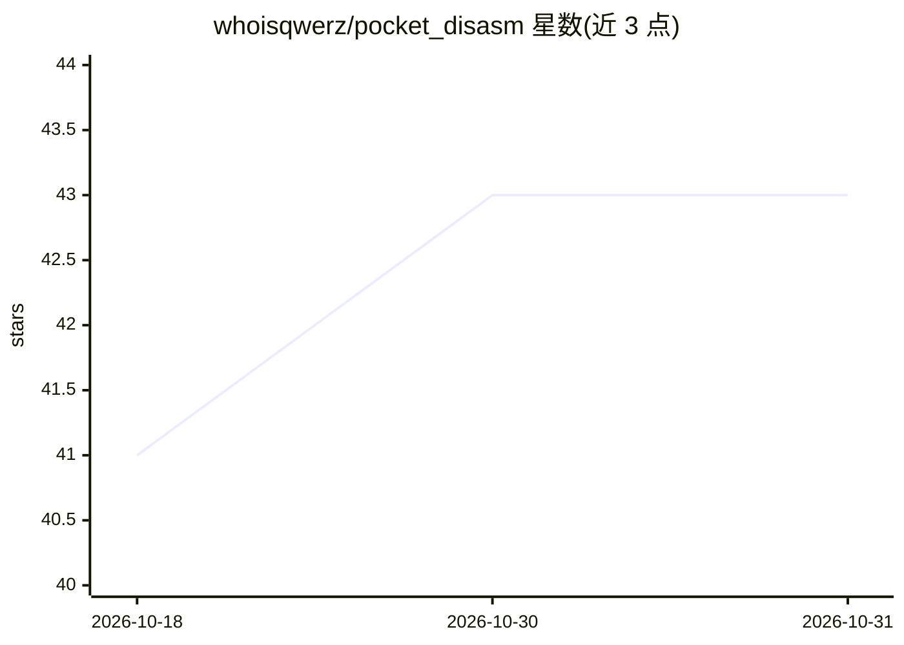

# whoisqwerz/pocket_disasm

⭐ 43 · Python · MIT · 推送 2026-07-12 · [GitHub](https://github.com/whoisqwerz/pocket_disasm) · 个人维护

**多会话 IDALib MCP 路由器：编码 agent 并行逆向分析多个二进制**

面向编码 agent 的 Windows 端 MCP 控制层：运行单一可流式 HTTP 端点（默认 127.0.0.1:13339/mcp），为每个二进制创建独立 IDALib worker 进程，通过 idb_open/idb_select 等会话管理工具实现多 agent 并行分析。以 mrexodia/ida-pro-mcp 固定版本为核心分析实现，TUI 可配置 Codex、Claude Code、Cursor、VS Code、Windsurf 集成。限制：需用户另行安装并持有 IDA/IDALib 许可证，项目本身不分发 Hex-Rays 软件。PowerShell 脚本一键安装。

## 筛选速览

| 维度 | 判定 | 备注 |
|---|---|---|
| AI 角色 | `ai-ecosystem` | LLM/agent 周边工具 |
| 许可风险 | `permissive` | MIT |
| 部署形态 | `desktop` | 安装包/桌面程序 |
| 模型依赖 | — | README 未给出锁定关系 |
| 硬件要求 | — | 无带数字的原话,不猜 |
| 安装摩擦 | `low` | 无编译、无系统依赖或容器化 |
| 成熟度 | — | 结构信号不足 |

## 能力要点

- 单一 MCP 端点下每个二进制独立 IDALib 进程（默认 8 worker，可配 1-128）
- 在 IDA MCP 工具目录之上增加 idb_open/idb_select 等会话管理工具
- TUI 一键配置 Codex、Claude Code、Cursor、VS Code、Windsurf
- 无 IDA GUI 自动化，worker 直接使用 IDALib

## 适用场景

- 让编码 agent 同时逆向分析多个二进制文件而无需为每个文件启动 IDA
- 在 Cursor/VS Code 等编辑器 agent 中接入 IDA 兼容的逆向分析工具
- 恶意样本分析时按会话隔离多个样本的分析环境

## 场景标签

`编码 Agent` `网络安全` · 领域:编码与开发

## 证据(README 行号)

> L5: **One MCP endpoint. Many isolated IDALib sessions.**
> L21: Pocket Disasm runs one public MCP router and gives every binary its own IDALib
> L54: - **True multi-session analysis** — each binary runs in an independent IDALib process.

## 星数曲线

2026-10-18 41 → 2026-10-31 43（+2）

---
*卡片 v1 · prompt 1.4 · 生成 2026-10-25 · 置信度 high · 依据 README sha `5d1d0914ad73` · [字段定义](../../DATASET.md)*
