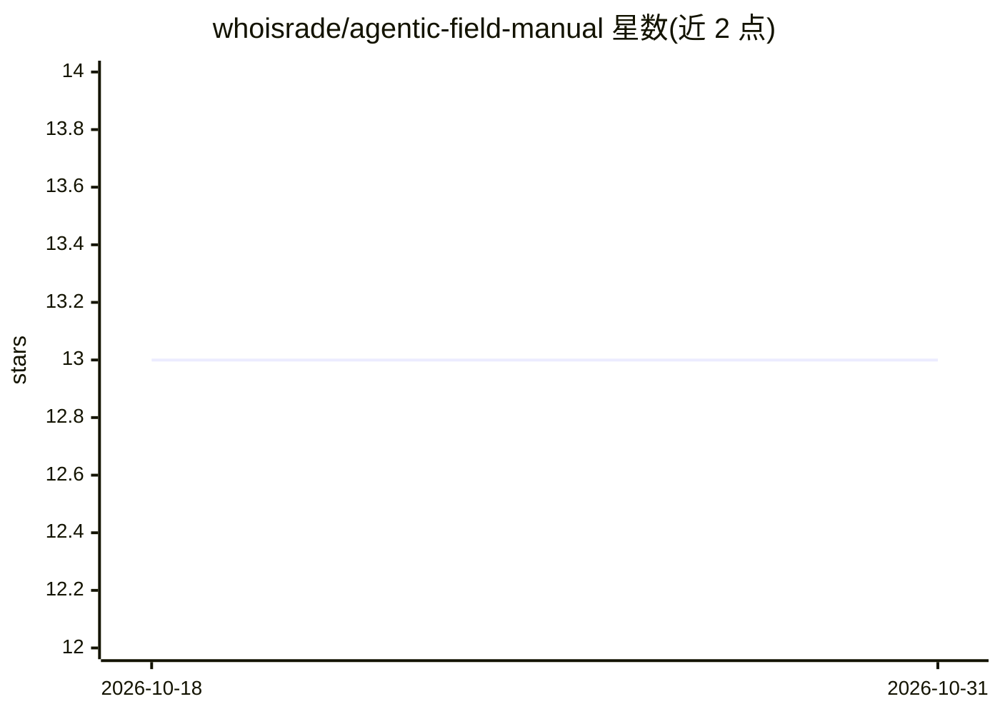

# whoisrade/agentic-field-manual

⭐ 13 · MIT · 推送 2026-03-10 · [GitHub](https://github.com/whoisrade/agentic-field-manual) · [官网](https://github.com/whoisrade/agentic-field-manual) · 个人维护

**生产级 AI 系统运维手册：架构模式、失效模式与运维剧本**

一份面向生产环境 agentic 系统的运维知识文档库（MIT 许可）：归纳 4 种失效模式、3 项不可逆决策等架构模式，提供成本调查、危机处置、上线前检查清单等运维剧本与模板，以及评估表、指标公式、SQL 查询示例和生产代码样例。目标读者为继承或构建 agentic 系统的资深工程师、CTO/VP、AI/ML 工程师与平台团队。内容以 Markdown 文档形式组织，含按主题导航的完整索引。

## 筛选速览

| 维度 | 判定 | 备注 |
|---|---|---|
| AI 角色 | `ai-knowledge` | 知识聚合/清单类 |
| 许可风险 | `permissive` | MIT |
| 部署形态 | `None` |  |
| 模型依赖 | — | README 未给出锁定关系 |
| 硬件要求 | — | 无带数字的原话,不猜 |
| 安装摩擦 | `low` | 无编译、无系统依赖或容器化 |
| 成熟度 | — | 结构信号不足 |

## 能力要点

- 归纳 4 种失效模式（可读性丧失、控制面漂移、审计缺口、利润脆弱）及对应修复方案
- 提供 10 分钟系统自评估与评分
- 含运维模板：危机剧本、成本飙升 Runbook、周运维清单、事故复盘等
- 给出推理日志记录代码与成本 SQL 查询示例

## 适用场景

- 接手 agentic 系统后做系统性评估与风险识别
- 成本飙升或事故时按 Runbook 排查处置
- 上线前对照检查清单与架构决策记录

## 场景标签

`教程课程` · 领域:学习与行业

## 证据(README 行号)

> L13: **Agentic systems fail silently, expensively, then catastrophically.** This manual gives you the patterns, checklis
> L85: |Resource|Purpose|

## 星数曲线

2026-10-18 13 → 2026-10-31 13（+0）

---
*卡片 v1 · prompt 1.4 · 生成 2026-10-31 · 置信度 high · 依据 README sha `c58c6c28ca31` · [字段定义](../../DATASET.md)*
