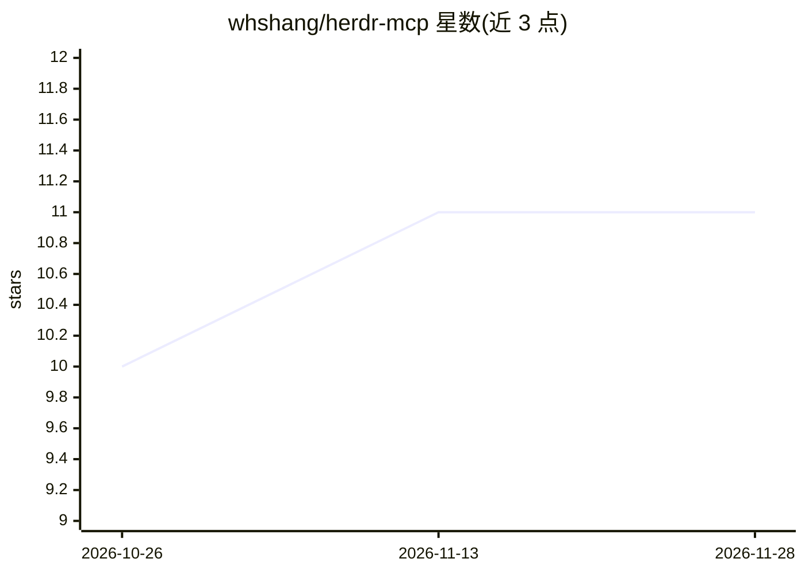

# whshang/herdr-mcp

⭐ 11 · Rust · 推送 2026-11-27 · [GitHub](https://github.com/whshang/herdr-mcp) · [官网](https://whshang.github.io/herdr-mcp/) · 个人维护 · 中文 README

**让网页 AI 通过 Connector 读写本地文件并调度 Coding Agent**

基于 Herdr 的 MCP 服务：通过 Cloudflare Worker 作为公网入口，把 ChatGPT、Claude、Grok 等网页对话接入用户的 macOS/Linux/Windows 工作站，提供 18 个确定性 MCP 工具（读写文件、Patch、Git、运行测试），并可把复杂任务派发给本机的 Codex、Claude Code、Cline 等本地 Agent。设备通过主动外连保持零公网入站端口，按 device_id 路由并拒绝盲猜目标；mutation 区分 applied/not_applied/uncertain 交付语义，支持 Sigstore 验签的一键自更新与回滚。仅支持 Herdr TUI，不支持 WSL。

## 筛选速览

| 维度 | 判定 | 备注 |
|---|---|---|
| AI 角色 | `ai-ecosystem` | LLM/agent 周边工具 |
| 许可风险 | `none` | — |
| 部署形态 | `None` |  |
| 模型依赖 | — | README 未给出锁定关系 |
| 硬件要求 | — | 无带数字的原话,不猜 |
| 安装摩擦 | `low` | 无编译、无系统依赖或容器化 |
| 成熟度 | — | 结构信号不足 |

## 能力要点

- 18 个确定性 MCP 工具直接读写文件、Patch、Git、跑测试
- 单个 Cloudflare Worker 登记多台工作站，按 device_id 路由并拒绝盲猜
- 复杂任务派发给本机任意 Coding Agent（Codex、Claude Code、Cline 等）
- mutation 交付语义区分 applied/not_applied/uncertain，支持 Sigstore 验签自更新

## 适用场景

- 在 ChatGPT Project 里直接操作本地项目的 Git 与测试修复
- 多台电脑通过一套入口按指令分工执行后端修改与独立测试
- 本地 Coding Agent 创建和接力 ChatGPT/Claude/Grok 网页会话

## 场景标签

`编码 Agent` · 领域:编码与开发

## 证据(README 行号)

> L5: 让 ChatGPT、Claude、Grok 等 Web AI 在你自己的电脑上持续开发：读写文件、使用 Git、运行命令和测试、并发调度本地 Coding Agent，并通过浏览器连续性与受控页面适配器在多台电脑之间闭环协作。
> L73: - **确定性工具 + 多 Coding Agent 协同。** 读写、Patch、Git、测试直接走 18 个确定性 MCP 工具；复杂任务可派发给 Codex、Claude Code、Pi、Cline、OpenCode 等任意

## 星数曲线

2026-10-26 10 → 2026-11-28 11（+1）

---
*卡片 v1 · prompt 1.4 · 生成 2026-11-18 · 置信度 high · 依据 README sha `88e19797bd3b` · [字段定义](../../DATASET.md)*
