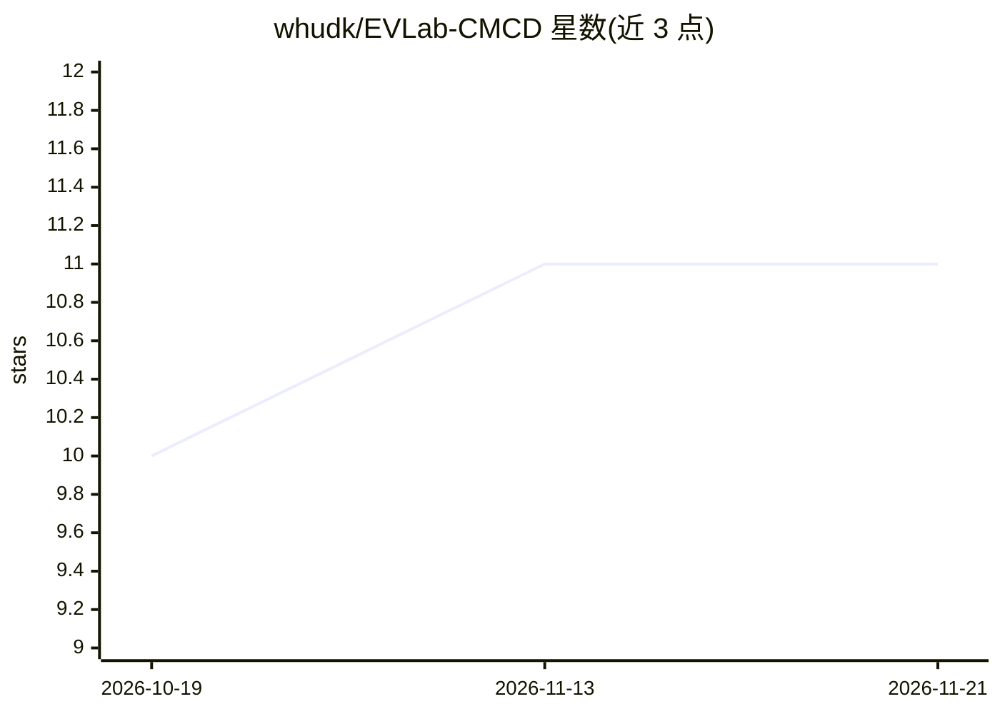

# whudk/EVLab-CMCD

⭐ 11 · Python · MIT · 推送 2026-10-19 · [GitHub](https://github.com/whudk/EVLab-CMCD) · 组织维护 · 中文 README

**历史土地利用图与遥感影像的跨模态变化检测**

EVLab-CMCD 仓库提供 CMPANet 变化检测模型的清理版单卡 PyTorch 实现、配套 EVLab-CMCD 数据集说明、训练与评估脚本，以及 cmpanet_small_head_24 权重的评估协议。架构采用 ViT-S/16 地图编码器、冻结 ViT-B/16 图像编码器、CCMAT（24 头）、TBAM 融合与 UperHead 解码器；验证集 397 对样本上给出公开可复现的指标。限制：仅支持单张 CUDA GPU，Linux 路径未独立验证，历史完整源码未完全恢复，数据集仅限学术研究用途。

## 筛选速览

| 维度 | 判定 | 备注 |
|---|---|---|
| AI 角色 | `ai-native` | 本体是模型或模型工具 |
| 许可风险 | `permissive` | MIT |
| 部署形态 | `library` | 以包/库形式分发 |
| 模型依赖 | — | README 未给出锁定关系 |
| 硬件要求 | — | 无带数字的原话,不猜 |
| 安装摩擦 | `medium` | 含编译或系统依赖之一 |
| 成熟度 | — | 结构信号不足 |

## 能力要点

- 提供 397 对验证样本上完整评估的发布权重与公开评估器
- 历史土地利用图（85 类灰度码）与当前光学影像的跨模态变化检测
- 含训练、评估、单元测试与合成数据冒烟测试脚本
- EVLab-CMCD 基准数据集（训练 5,225 对，0.8 m 分辨率）

## 适用场景

- 对比历史土地利用图与最新影像生成变化检测结果
- 在 EVLab-CMCD 基准上训练或评估变化检测模型
- 复现论文报告的评估指标

## 场景标签

`图像视频处理` · 领域:感知与多模态

## 证据(README 行号)

> L8: CMPANet detects changes between historical land-use maps and current optical imagery. This repository provides the E
> L10: The released configuration uses a **ViT-S/16 map encoder**, a **frozen ViT-B/16 image encoder**, CCMAT with **24 at

## 星数曲线

2026-10-19 10 → 2026-11-21 11（+1）

---
*卡片 v1 · prompt 1.4 · 生成 2026-11-18 · 置信度 high · 依据 README sha `3a41bb6ed529` · [字段定义](../../DATASET.md)*
