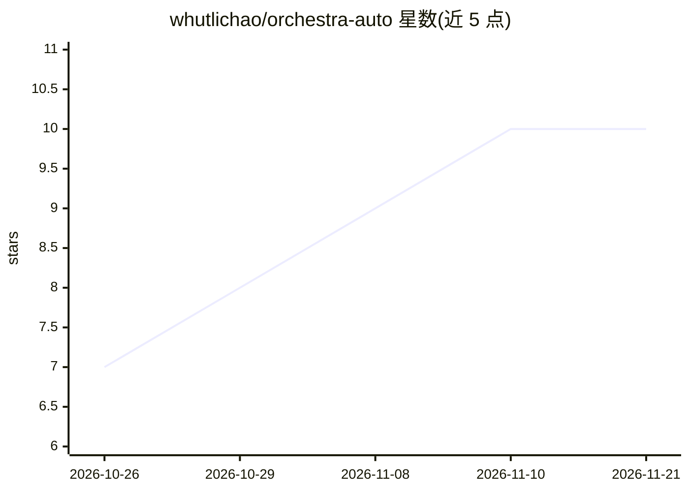

# whutlichao/orchestra-auto

⭐ 10 · Python · MIT · 推送 2026-11-20 · [GitHub](https://github.com/whutlichao/orchestra-auto) · 个人维护 · 中文 README

**把 Matt Pocock 工程技能链编排到 Orca 上的 Agent Skill**

一个可安装的 Agent Skill，在 Orca 上按固定链条运行 grill-with-docs、to-spec、to-tickets、implement/implement-spec 与 code-review：协调者每步派发一个 worker 在独立 worktree 中执行，工件通过对应 gate 后，由人授权合并 PR。提供中英两个技能变体、flow 记录与 resume/exit-check 检查脚本。限制：仅驱动 Orca CLI，需预先安装 Orca 与 Matt Pocock 的技能本体，不具通用编排能力，命令不可移植。

## 筛选速览

| 维度 | 判定 | 备注 |
|---|---|---|
| AI 角色 | `ai-ecosystem` | LLM/agent 周边工具 |
| 许可风险 | `permissive` | MIT |
| 部署形态 | `library` | 以包/库形式分发 |
| 模型依赖 | — | README 未给出锁定关系 |
| 硬件要求 | — | 无带数字的原话,不猜 |
| 安装摩擦 | `low` | 无编译、无系统依赖或容器化 |
| 成熟度 | — | 结构信号不足 |

## 能力要点

- 以单一连续流程运行 Matt Pocock 技能链，人只在 gate 处介入
- 每步 worker 在独立 top-level worktree 中执行，默认开 PR、授权后合并
- flow.py 写入版本化流程记录（节点/依赖/gate/证据），支持 resume 与 exit-check
- 提供英文与简体中文两个独立技能包

## 适用场景

- 在 Orca 中把需求从访谈到规格、工单到实现一次跑通
- 需要多人格 worker 在隔离 worktree 并行实现同一 spec 的工单
- 希望合并等不可逆操作保留人工决策点的开发流程

## 场景标签

`多智能体` `编码 Agent` · 领域:Agent 开发

## 证据(README 行号)

> L9: An Agent Skill that runs Matt Pocock's engineering chain on Orca as one continuous flow: you say what you want, a co
> L11: > **Requires Orca and Matt Pocock's skills.** It drives the Orca CLI; it is not a general orchestrator. Read Prereq
> L116: |Orca|The Orca app with a reachable CLI. The skills call `orca orchestration worker-start`, `check`, `send`, `repl

## 星数曲线

2026-10-26 7 → 2026-11-21 10（+3）

---
*卡片 v1 · prompt 1.4 · 生成 2026-11-19 · 置信度 high · 依据 README sha `d191a9e054d0` · [字段定义](../../DATASET.md)*
