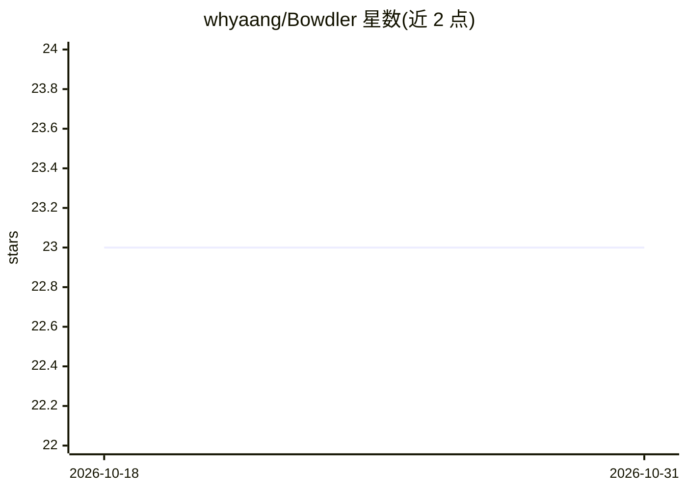

# whyaang/Bowdler

⭐ 23 · NOASSERTION · 推送 2026-07-28 · [GitHub](https://github.com/whyaang/Bowdler) · [官网](https://bowdler.app) · 个人维护

**Mac 本地 AI 视频文本编辑器：剪静音、消音脏话、生成字幕**

运行于 Apple Silicon Mac 的视频编辑应用（非开源，Gumroad 售许可证）：通过编辑转写文本来剪辑视频，支持选中删除句词、去除填充词与废片、静音检测移除（可调灵敏度与最短时长）、脏话静音或蜂鸣替换（内置 32 种语言词表并支持自定义）、字幕生成与 32 种语言自动翻译，导出 SRT/VTT/FCPXML 或 MP4/MOV（最高 4K），也可导出时间线至 Final Cut Pro、DaVinci Resolve、Adobe Premiere。全部 AI 处理本地运行，无需联网。要求 macOS 14+ 与 M1 及以上芯片。

## 筛选速览

| 维度 | 判定 | 备注 |
|---|---|---|
| AI 角色 | `ai-native` | 本体是模型或模型工具 |
| 许可风险 | `none` | NOASSERTION |
| 部署形态 | `desktop` | 安装包/桌面程序 |
| 模型依赖 | — | README 未给出锁定关系 |
| 硬件要求 | — | 无带数字的原话,不猜 |
| 安装摩擦 | `low` | 无编译、无系统依赖或容器化 |
| 成熟度 | — | 结构信号不足 |

## 能力要点

- 转写文本驱动的视频剪辑：删句、去填充词、去废片
- 静音检测移除与脏话静音/蜂鸣替换（32 语言词表+自定义）
- 字幕生成与 32 语言自动翻译，导出 SRT/VTT/FCPXML
- 全部 AI 模型本地运行于 Apple Silicon，无需联网与账号

## 适用场景

- 通过编辑文字快速剪掉口误、填充词与静音片段
- 给视频自动上字幕并翻译成多语言
- 把粗剪结果导出到 Final Cut Pro / DaVinci 做后续精修

## 场景标签

`语音识别` `图像视频处理` · 领域:感知与多模态

## 证据(README 行号)

> L19: Bowdler automates and simplifies the whole editing routine using simple tools and local AI: silence, transcript, su
> L51: Bowdler runs locally on Apple Silicon, so no internet connection required, no cloud processing, no accounts. Every 

## 星数曲线

2026-10-18 23 → 2026-10-31 23（+0）

---
*卡片 v1 · prompt 1.4 · 生成 2026-10-27 · 置信度 high · 依据 README sha `87f1988e9f86` · [字段定义](../../DATASET.md)*
