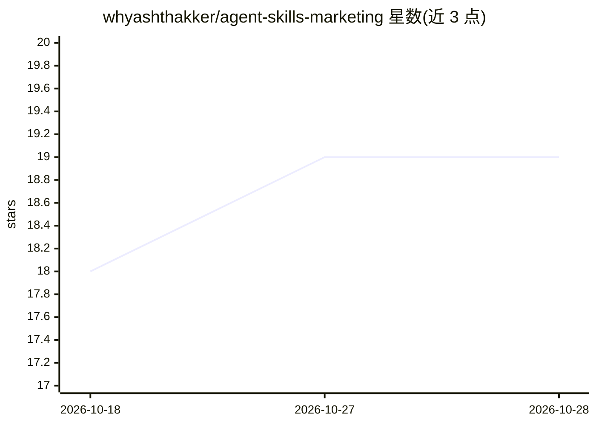

# whyashthakker/agent-skills-marketing

⭐ 19 · Python · MIT · 推送 2026-06-23 · [GitHub](https://github.com/whyashthakker/agent-skills-marketing) · [官网](https://www.explainx.ai) · 组织维护

**营销领域 agent 技能库：50+ 可复用 SKILL.md 技能源**

面向营销与创作者运营的 agent 技能库：以 SKILL.md 自包含文件夹形式提供 50 余个技能，覆盖内容文案、SEO/GEO、创作者与红人工作流、生命周期增长、市场研究与销售支持等类别。每项技能含触发规则、参考文档、示例与插件元数据。仓库同时提供 .agents/skills 通用副本与 .claude/skills 面向 Claude 的镜像，通过 git clone 与目录复制安装，在 Claude Code 等 agent 中按自然语言请求触发使用。

## 筛选速览

| 维度 | 判定 | 备注 |
|---|---|---|
| AI 角色 | `ai-knowledge` | 知识聚合/清单类 |
| 许可风险 | `permissive` | MIT |
| 部署形态 | `None` |  |
| 模型依赖 | — | README 未给出锁定关系 |
| 硬件要求 | — | 无带数字的原话,不猜 |
| 安装摩擦 | `low` | 无编译、无系统依赖或容器化 |
| 成熟度 | — | 结构信号不足 |

## 能力要点

- 50+ 营销技能以自包含 SKILL.md 文件夹形式组织
- 双目录结构：.agents/skills 通用版与 .claude/skills Claude 镜像
- 技能按 5 大类组织：内容文案、SEO/GEO、创作者工作流、增长漏斗、研究定位
- 支持整库复制或单个技能文件夹复制安装

## 适用场景

- 为 Claude Code 等 agent 配备营销文案与 SEO/GEO 技能
- 生成红人合作 brief、UGC brief 与创作者活动计划
- 搭建营销漏斗、留存与 KPI 看板等工作流

## 场景标签

`AI 写作` `精选清单` · 领域:内容生成

## 证据(README 行号)

> L3: A reusable library of agent skills for marketing, creator
> L21: Each skill is a self-contained folder with:
> L23: - `SKILL.md` for trigger rules and workflow instructions

## 星数曲线

2026-10-18 18 → 2026-10-28 19（+1）

---
*卡片 v1 · prompt 1.4 · 生成 2026-10-28 · 置信度 high · 依据 README sha `93aed2a426c8` · [字段定义](../../DATASET.md)*
