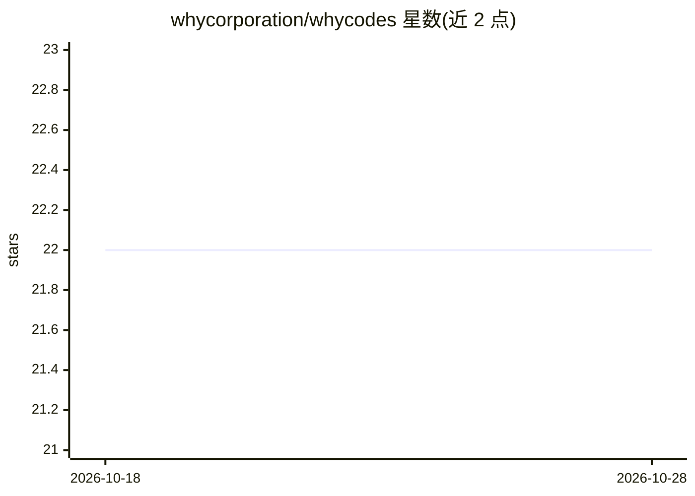

# whycorporation/whycodes

⭐ 22 · Rust · MIT · 推送 2026-10-27 · [GitHub](https://github.com/whycorporation/whycodes) · [官网](https://why.codes) · 组织维护 · 中文 README

**Rust 编写的终端编码 agent，支持多模型提供方**

单二进制终端编码 agent：读写编辑文件、执行命令、搜索工作区，通过多轮工具调用驱动 LLM，提供全屏 TUI 与机器可读的一次性 CLI 两种模式。支持 Anthropic、OpenAI、Ollama、vLLM、LM Studio 等多种提供方及任意 OpenAI 兼容端点，可运行中切换。特性含多 agent/swarm 并行、持久化会话与分支、MEMORY.md 跨会话记忆、MCP/LSP 接入、headless JSON 输出与审批/沙箱安全机制。Windows 命令可不经 WSL 运行。

## 筛选速览

| 维度 | 判定 | 备注 |
|---|---|---|
| AI 角色 | `ai-native` | 本体是模型或模型工具 |
| 许可风险 | `permissive` | MIT |
| 部署形态 | `library` | 以包/库形式分发 |
| 模型依赖 | local-ok | 支持本地模型 |
| 硬件要求 | — | 无带数字的原话,不猜 |
| 安装摩擦 | `medium` | 含编译或系统依赖之一 |
| 成熟度 | — | 结构信号不足 |

## 能力要点

- 单一原生二进制，Linux --version 1.4 ms，空闲 TUI 零帧重绘
- 多提供方接入：托管 API、本地模型服务器及任意 OpenAI 兼容端点，运行中可切换
- 持久化会话可分支/恢复，MEMORY.md 与语义记忆、可选代码索引
- MCP 服务器、LSP 语言服务器、技能、shell 插件扩展机制

## 适用场景

- 在终端里让 AI agent 读写代码、跑测试完成开发任务
- 本地模型（Ollama/vLLM/llama.cpp）驱动的离线编码助手
- CI 中以 headless JSON 输出批量运行 agent 任务

## 场景标签

`编码 Agent` `多智能体` · 领域:Agent 开发

## 证据(README 行号)

> L12: WhyCodes reads, writes and edits files, runs commands, searches the workspace
> L13: and drives an LLM through multi-turn tool use — in a full-screen TUI or as a
> L14: machine-readable one-shot CLI. It focuses on a small native footprint, an

## 星数曲线

2026-10-18 22 → 2026-10-28 22（+0）

---
*卡片 v1 · prompt 1.4 · 生成 2026-10-27 · 置信度 high · 依据 README sha `46c333e7a303` · [字段定义](../../DATASET.md)*
