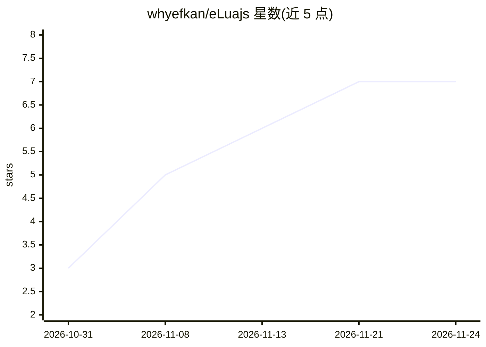

# whyefkan/eLuajs

⭐ 7 · Java · Apache-2.0 · 推送 2026-11-12 · [GitHub](https://github.com/whyefkan/eLuajs) · 个人维护

**面向 Android Java 开发者的轻量 IDE，内置 AI 编码助手**

基于 Java/Swing 的 Android Java IDE，覆盖 Linux 与 Windows：创建标准 Gradle 项目、编写 Java+XML、校验并导出 debug APK 或签名的 Play Store AAB。内置 agentic AI 助手：读取项目文件树、按需读取文件、提出 WRITE/DELETE 补丁并经 diff 审批后应用，可撤销 AI 编辑，按项目保存会话；API key 本地存储，本地 Ollama 无需 key。安装包自带 Java 运行时，无需系统 Java。

## 筛选速览

| 维度 | 判定 | 备注 |
|---|---|---|
| AI 角色 | `ai-enhanced` | 去掉 AI 部分产品仍成立 |
| 许可风险 | `permissive` | Apache-2.0 |
| 部署形态 | `desktop` | 安装包/桌面程序 |
| 模型依赖 | local-ok | 支持本地模型 |
| 硬件要求 | — | 无带数字的原话,不猜 |
| 安装摩擦 | `high` | 编译与系统依赖俱全 |
| 成熟度 | — | 结构信号不足 |

## 能力要点

- AI 助手经 diff 审批直接编辑文件，可撤销最近一次 AI 修改
- 一键构建 debug APK 或签名 Play Store AAB，含 ADB 安装与版本号递增
- 支持 OpenAI/Claude/Gemini/Groq/DeepSeek/OpenRouter/本地 Ollama 及 OpenAI 兼容端点
- 便携包自带 Java 运行时，无 Electron，内存占用小

## 适用场景

- 在旧电脑上编写并构建 Android Java 应用
- 通过 AI 助手以对话方式修改项目并审阅变更
- 生成签名 AAB 用于 Play Store 发布
- 用本地 Ollama 在无 API key 环境下使用 AI 辅助

## 场景标签

`AI 助手` `编码 Agent` · 领域:编码与开发

## 证据(README 行号)

> L5:  A lightweight Android Java IDE for Linux and Windows.
> L28: - **Agentic AI assistant** — reads the project, edits files directly, reloads the editor, reports what changed and 
> L79: - **AI providers** — latest OpenAI GPT-6 family, Claude Fable/Opus/Sonnet/Haiku 5.x, Gemini 4/3.x, Groq, DeepSeek, 

## 星数曲线

2026-10-31 3 → 2026-11-24 7（+4）

---
*卡片 v1 · prompt 1.4 · 生成 2026-11-20 · 置信度 high · 依据 README sha `61d2a256928e` · [字段定义](../../DATASET.md)*
