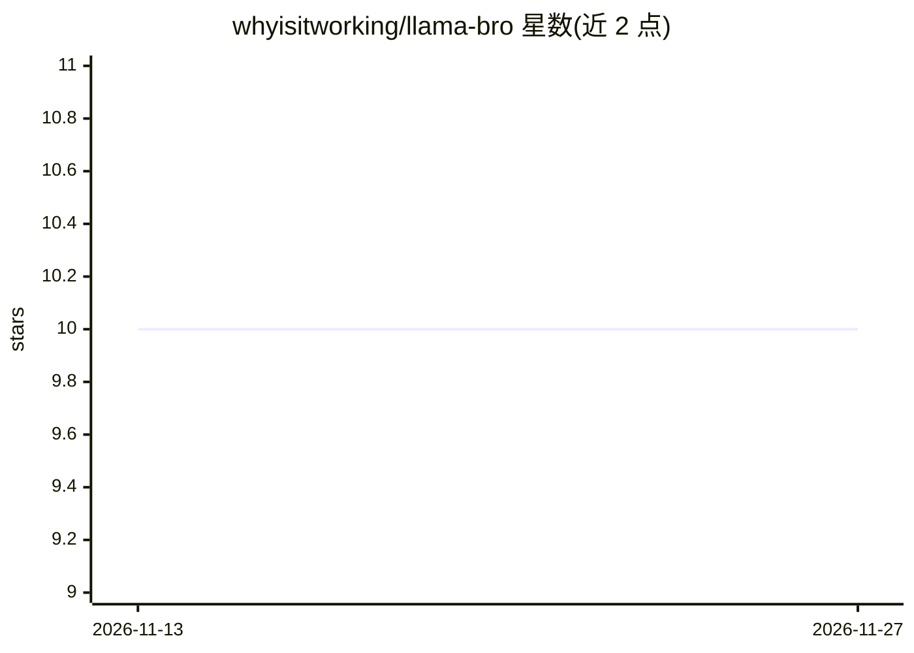

# whyisitworking/llama-bro

⭐ 10 · Kotlin · Apache-2.0 · 推送 2026-11-26 · [GitHub](https://github.com/whyisitworking/llama-bro) · 个人维护

**Android 离线运行 GGUF 模型的 Kotlin SDK**

封装 llama.cpp 的 Android SDK，让开发者在设备端加载并运行 GGUF 量化模型（Llama 3、Gemma、Qwen 2.5、DeepSeek-R1 等），全程离线、无需 API key。提供 Kotlin Coroutines Flow API：声明式推理流水线、零分配 token 流式扫描、<think> 思考块抽取、6 种内置聊天模板、KV 缓存溢出三种策略、类型化 JNI 错误。经 JitPack 分发，要求 Android API 24+，模型需从 Hugging Face 自行下载。

## 筛选速览

| 维度 | 判定 | 备注 |
|---|---|---|
| AI 角色 | `ai-ecosystem` | LLM/agent 周边工具 |
| 许可风险 | `permissive` | Apache-2.0 |
| 部署形态 | `None` |  |
| 模型依赖 | local-ok | 支持本地模型 |
| 硬件要求 | — | 无带数字的原话,不猜 |
| 安装摩擦 | `low` | 无编译、无系统依赖或容器化 |
| 成熟度 | — | 结构信号不足 |

## 能力要点

- 封装 llama.cpp 的 Kotlin Coroutines Flow API（LlamaEngine/LlamaSession/LlamaChatSession 三层）
- 声明式推理流水线，ResourceState ADT 组合资源加载
- 6 种内置聊天模板与自定义 PromptFormat，支持 <think> 思考块抽取
- KV 缓存溢出三策略（Halt/ClearHistory/RollingWindow）与类型化 LlamaError

## 适用场景

- 在 Android 应用中离线运行本地 LLM 聊天
- 开发隐私敏感场景（不上传数据）的端侧 AI 功能
- 为推理模型（DeepSeek-R1/QwQ）分离思考文本与回答文本

## 场景标签

`推理引擎` · 领域:训练与推理

## 证据(README 行号)

> L22: We wrap llama.cpp in a clean, idiomatic Kotlin SDK so you can run state-of-the-art models — Llama 3, Gemma, DeepSee
> L90:     implementation("com.github.whyisitworking:llama-bro:<LATEST_VERSION>")

## 星数曲线

2026-11-13 10 → 2026-11-27 10（+0）

---
*卡片 v1 · prompt 1.4 · 生成 2026-11-19 · 置信度 high · 依据 README sha `5d68ae501eb3` · [字段定义](../../DATASET.md)*
