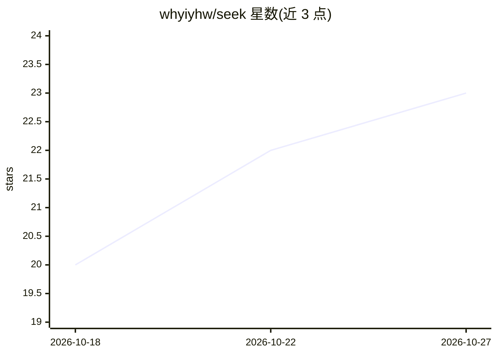

# whyiyhw/seek

⭐ 23 · Go · MIT · 推送 2026-09-10 · [GitHub](https://github.com/whyiyhw/seek) · [官网](https://seek.whyiyhw.com) · 个人维护 · 中文 README

**本地终端编码 agent 平台：计划、子 agent 并行与定时任务**

以单个约 6MB 静态 Go 二进制运行的终端编码 agent 平台，无守护进程、无遥测。DeepSeek 优先，同时支持 OpenAI / Anthropic / Gemini 及 OpenAI 兼容端点（KIMI 等），用户自带 API key。核心机制：/plan 审批门控流程、子 agent 在独立 git worktree 中并行执行、基于 launchd/systemd/Task Scheduler 的零守护 cron 调度、三级记忆、OS 级沙箱（seatbelt/landlock）、MCP 客户端与 ACP/Zed 支持。约 85k 行 Go，CI 在三平台 -race 测试，当前 v0.10.3，MIT 许可。

## 筛选速览

| 维度 | 判定 | 备注 |
|---|---|---|
| AI 角色 | `ai-native` | 本体是模型或模型工具 |
| 许可风险 | `permissive` | MIT |
| 部署形态 | `None` |  |
| 模型依赖 | locked-api |  |
| 硬件要求 | — | 无带数字的原话,不猜 |
| 安装摩擦 | `low` | 无编译、无系统依赖或容器化 |
| 成熟度 | — | 结构信号不足 |

## 能力要点

- 单个静态 Go 二进制（约 6MB），无守护进程、无遥测、无 Python/Node 运行时
- 子 agent 在各自隔离的 git worktree 中并行工作
- 零守护 cron 调度（launchd/systemd/Task Scheduler）与 webhook 推送到手机
- OS 级沙箱（seatbelt / landlock）、三级记忆、MCP 客户端、ACP/Zed 支持

## 适用场景

- 在终端里让 agent 按计划自主完成编码任务并提交
- 夜间定时无人值守运行任务并把结果推送到手机
- 配合 DeepSeek 等自有 key 做低成本的代码审查与批量小改动

## 场景标签

 · 领域:软件开发/AI 编码助手

## 证据(README 行号)

> L11: A coding agent that runs as a single **static Go binary** in your terminal — a **~6 MB download**, **no daemon, no 
> L19: - **🧭 Plans before it acts** — `/plan` gates work behind `analyze → propose → you approve → execute`. Read-only unt
> L21: - **🌙 Ships while you sleep** — **zero-daemon** scheduling on your OS (launchd / systemd / Task Scheduler). `seek c

## 星数曲线

2026-10-18 20 → 2026-10-27 23（+3）

---
*卡片 v1 · prompt 1.4 · 生成 2026-10-27 · 置信度 high · 依据 README sha `2c5a451d485a` · [字段定义](../../DATASET.md)*
