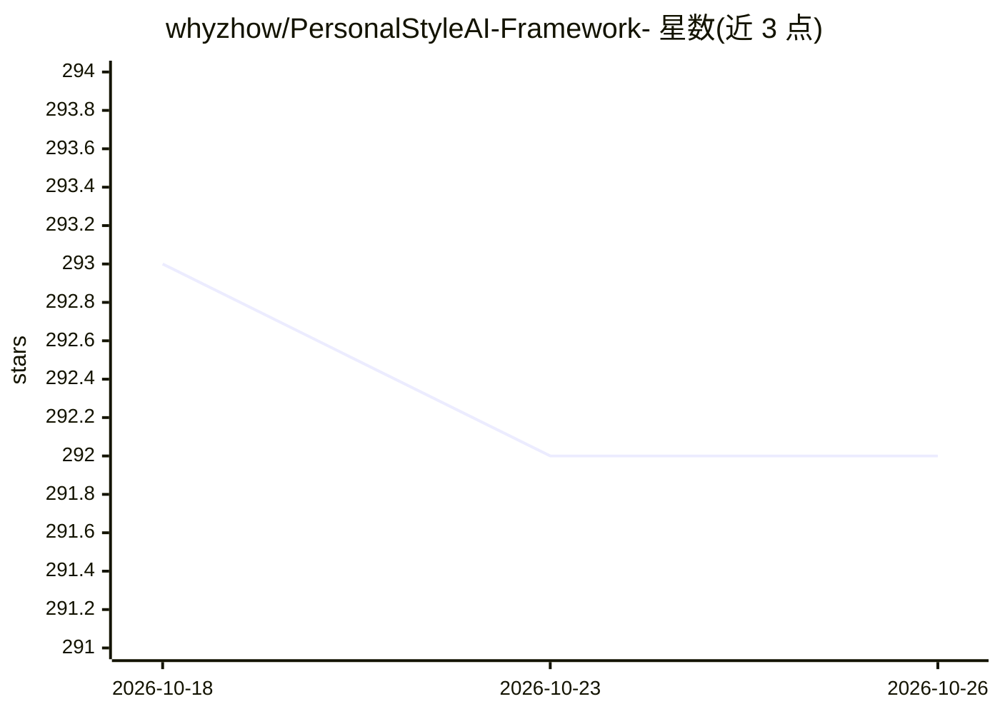

# whyzhow/PersonalStyleAI-Framework-

⭐ 292 · Python · 推送 2026-03-21 · [GitHub](https://github.com/whyzhow/PersonalStyleAI-Framework-) · 个人维护

**用个人聊天记录构建专属语言风格 AI 的框架**

个人风格定制流水线框架，分三阶段：清洗原始聊天记录（去表情/链接/垃圾信息）生成 JSONL 对话对；通过工厂模式的适配器层将个人风格加载到 GPT-4、Claude 或本地 Llama 3 等模型，切换后端只需改一行配置；再以 LoRA 做本地轻量微调将语言习惯固化进权重。支持 CUDA 显卡的本地训练组件可选安装，敏感信息用 .env 管理，依赖由 pyproject.toml 层级管理。

## 筛选速览

| 维度 | 判定 | 备注 |
|---|---|---|
| AI 角色 | `ai-ecosystem` | LLM/agent 周边工具 |
| 许可风险 | `none` | — |
| 部署形态 | `library` | 以包/库形式分发 |
| 模型依赖 | local-ok | 支持本地模型 |
| 硬件要求 | — | 无带数字的原话,不猜 |
| 安装摩擦 | `medium` | 含编译或系统依赖之一 |
| 成熟度 | — | 结构信号不足 |

## 能力要点

- 聊天记录清洗为 JSONL 训练对话对
- 工厂模式适配器：一行配置切换 GPT-4/Claude/本地 Llama 3/Ollama
- LoRA 本地轻量微调，风格固化进模型权重

## 适用场景

- 把自己的聊天记录训练成个人风格 AI 对话
- 在不同模型后端间迁移个人风格配置
- 本地微调属于自己的语言风格模型

## 场景标签

`微调` · 领域:训练与推理

## 证据(README 行号)

> L2: Let AI think and express like you. This framework provides a complete assembly line: from the noise processing of or
> L13: Through a unified interface, your personal style can be easily loaded to GPT-4, Claude or local Llama 3.
> L51: Adopt factory model design. This means that if you want to switch from OpenAI to local Ollama, you only need to cha

## 星数曲线

2026-10-18 293 → 2026-10-26 292（-1）

---
*卡片 v1 · prompt 1.4 · 生成 2026-10-22 · 置信度 high · 依据 README sha `9782475b6507` · [字段定义](../../DATASET.md)*
