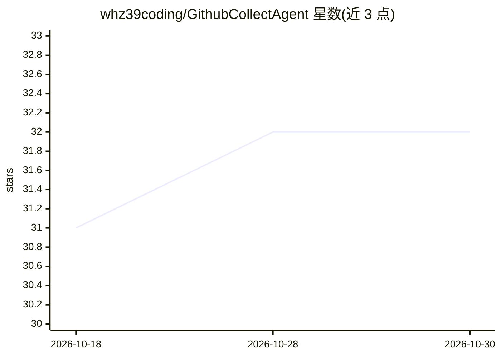

# whz39coding/GithubCollectAgent

⭐ 32 · Python · MIT · 推送 2026-07-24 · [GitHub](https://github.com/whz39coding/GithubCollectAgent) · 个人维护 · 中文 README

**定时抓取 GitHub Trending 并用 LLM 生成分析报告推送到 IM 的自动化 Agent**

基于 LLM 的开源情报收集工具：定时抓取 GitHub Trending（Daily/Weekly）榜单项目，自动读取并清洗 README 以节省 Token，再按可自定义的 Prompt 文件让大模型提取核心亮点并生成 2-3 个应用场景或商业思路，输出标准化 JSON 报告，经 Webhook 推送到飞书/钉钉等消息卡片。部署方式为 Fork 仓库并在 GitHub Actions 中配置 Secrets 运行，无需自购服务器；可修改 main.py 参数控制分析长度与数量、语言筛选条件。

## 筛选速览

| 维度 | 判定 | 备注 |
|---|---|---|
| AI 角色 | `ai-native` | 本体是模型或模型工具 |
| 许可风险 | `permissive` | MIT |
| 部署形态 | `None` |  |
| 模型依赖 | — | README 未给出锁定关系 |
| 硬件要求 | — | 无带数字的原话,不猜 |
| 安装摩擦 | `low` | 无编译、无系统依赖或容器化 |
| 成熟度 | — | 结构信号不足 |

## 能力要点

- 定时抓取 GitHub Trending 榜单（可设筛选条件与发送时间）
- AI 深度阅读 README 并按 Prompt 提取亮点与应用思路
- 自动清洗 README 干扰信息以节省 Token
- 基于 GitHub Actions 零成本部署，Webhook 推送飞书/钉钉消息卡片

## 适用场景

- 每天自动收到 GitHub 热门项目的 AI 分析日报
- 让 AI 代读冗长 README 并提取商业灵感或开发思路
- 无需服务器低成本跟踪开源趋势

## 场景标签

`网页抓取` `工作流自动化` · 领域:效率与自动化

## 证据(README 行号)

> L19: **你是否还在每天漫无目的地刷 GitHub Trending？或者是 忙于其他工作导致错过了一些好的Github项目而感到可惜？**
> L21: **GitHub Insight Agent** 是一个全自动化的开源情报探员。它不仅能帮你把每天最火的开源项目爬取下来，还能利用 **LLM (大语言模型)** 阅读冗长的 README 文档，提取核心价值，无需你登录到Gith

## 星数曲线

2026-10-18 31 → 2026-10-30 32（+1）

---
*卡片 v1 · prompt 1.4 · 生成 2026-10-26 · 置信度 high · 依据 README sha `c723cb31c9c2` · [字段定义](../../DATASET.md)*
