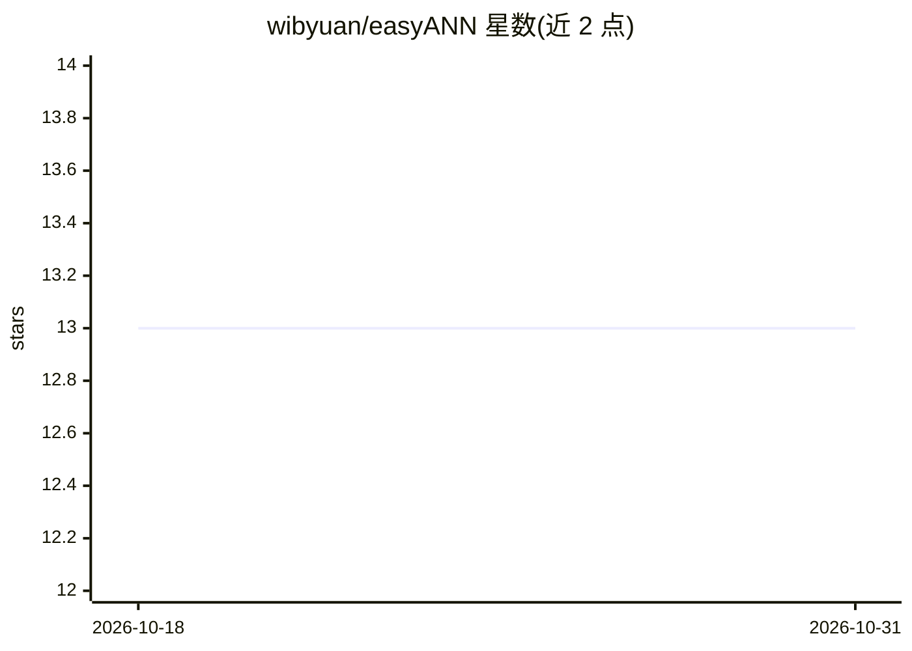

# wibyuan/easyANN

⭐ 13 · C++ · MIT · 推送 2026-01-22 · [GitHub](https://github.com/wibyuan/easyANN) · 个人维护

**30+ 种 ANN 算法变体的实现与基准对比沙盒（C++）**

C++ 项目，实现并基准测试 30 余种近似最近邻搜索算法变体，覆盖 HNSW、FlatNav（单层图）、ONNG 及 SIMD、多线程、SQ8/SQ16 量化、图重排序等优化，内置暴力搜索作为精确基线，附 hnswlib 与 FlatNav 官方库对照。提供统一接口（build/search），用户放入自己的实现即可一行命令对比构建/搜索时延与 Recall@10。包含消融实验框架，支持 gamma/efSearch 参数扫描、图缓存与断点续跑，在 SIFT(1M) 与 GLOVE(1.18M) 数据集上给出结果。构建需 C++17 编译器与 Python 3.8+，SIMD 实现为 x86 专用；基准在单节点 Windows 环境完成。

## 筛选速览

| 维度 | 判定 | 备注 |
|---|---|---|
| AI 角色 | `ai-ecosystem` | LLM/agent 周边工具 |
| 许可风险 | `permissive` | MIT |
| 部署形态 | `None` |  |
| 模型依赖 | — | README 未给出锁定关系 |
| 硬件要求 | — | 无带数字的原话,不猜 |
| 安装摩擦 | `medium` | 含编译或系统依赖之一 |
| 成熟度 | — | 结构信号不足 |

## 能力要点

- 30+ 种 ANN 算法变体与暴力搜索基线的统一评测沙盒
- 消融实验框架：参数自动扫描、图缓存、断点续跑、早停
- SIFT/GLOVE 数据集上的时延与 Recall@10 基准结果
- 自定义算法只需实现 build/search 接口即可加入对比

## 适用场景

- 我想对比自己写的 ANN 算法与 HNSW/FlatNav 基线的速度和召回
- 研究各优化（SIMD、量化、图重排序、剪枝）对 ANN 性能的实际影响
- 复现并扩展高维向量近邻搜索的消融实验

## 场景标签

`向量数据库` `模型评测` · 领域:评测与运维

## 证据(README 行号)

> L3: A comparative study of multiple Approximate Nearest Neighbor (ANN) search algorithms, implementing and benchmarking 
> L7: This project implements 30+ variants of ANN algorithms to find the K nearest neighbors in high-dimensional vector sp

## 星数曲线

2026-10-18 13 → 2026-10-31 13（+0）

---
*卡片 v1 · prompt 1.4 · 生成 2026-10-31 · 置信度 high · 依据 README sha `b5b9ce2934a9` · [字段定义](../../DATASET.md)*
