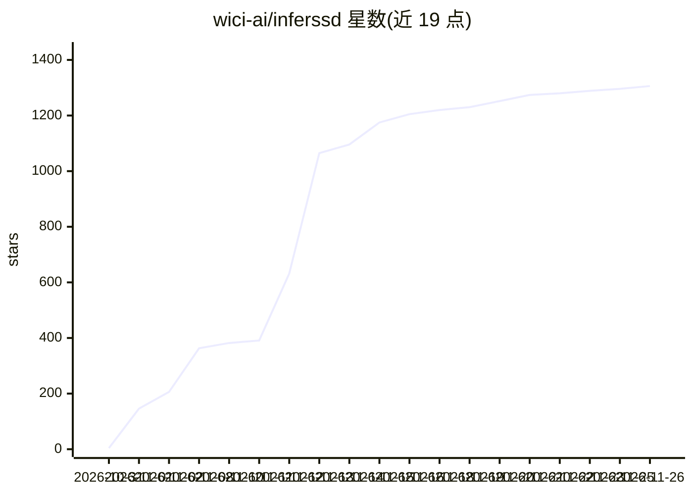

# wici-ai/inferssd

⭐ 1,306 · C++ · Apache-2.0 · 推送 2026-11-25 · [GitHub](https://github.com/wici-ai/inferssd) · [官网](https://wici.ai/wici-infer) · 组织维护 · 中文 README

**本地 LLM 推理运行时：从 SSD 流式加载超出内存的 MoE 模型**

基于 llama.cpp 构建的推理引擎，通过从 SSD 流式读取 MoE 专家权重，运行超出 RAM/VRAM 容量的大模型；使用标准 GGUF 文件，提供终端聊天、浏览器 Web UI 与 OpenAI 兼容 API（默认端口 8080，无鉴权）。macOS/Windows 提供预编译安装包，Linux 由安装脚本从源码构建，需 Git、Python 3.9+、C/C++ 编译器、systemd cgroup v2 及 CUDA 或 ROCm SDK。另有基于该引擎的免费桌面应用 WiCi Infer。

## 筛选速览

| 维度 | 判定 | 备注 |
|---|---|---|
| AI 角色 | `ai-ecosystem` | LLM/agent 周边工具 |
| 许可风险 | `permissive` | Apache-2.0 |
| 部署形态 | `None` |  |
| 模型依赖 | local-ok | 支持本地模型 |
| 硬件要求 | — | 无带数字的原话,不猜 |
| 安装摩擦 | `medium` | 含编译或系统依赖之一 |
| 成熟度 | — | 结构信号不足 |

## 能力要点

- SSD 流式加载 MoE 专家权重，无需模型适配内存
- 使用标准 GGUF 文件，列出多款模型的多档量化（233–508 GB）
- 提供 OpenAI 兼容 API（/v1）与浏览器聊天界面
- README 附四种硬件平台上的 token/s 基准表

## 适用场景

- 在 16–48 GB 内存的机器上运行 700+ B 参数的 MoE 模型
- 本地起一个 OpenAI 兼容 API 供其他客户端调用
- 在无终端的桌面环境下通过 WiCi Infer 下载模型并聊天

## 场景标签

`推理引擎` · 领域:训练与推理

## 证据(README 行号)

> L17: **Run models larger than your RAM or VRAM.** InferSSD builds on llama.cpp to run large mixture-of-experts (MoE) mod
> L116: **Desktop app.** WiCi Infer is a free app for macOS (Apple silicon) and Windows (x64), built on InferSSD. It sets 
> L130: On macOS 15 or later on Apple silicon and on Windows 10 or 11 x64, the installer downloads the release's prebuilt 

## 星数曲线

2026-10-31 4 → 2026-11-26 1,306（+1,302）

---
*卡片 v1 · prompt 1.4 · 生成 2026-11-23 · 置信度 high · 依据 README sha `dca6107c3214` · [字段定义](../../DATASET.md)*
