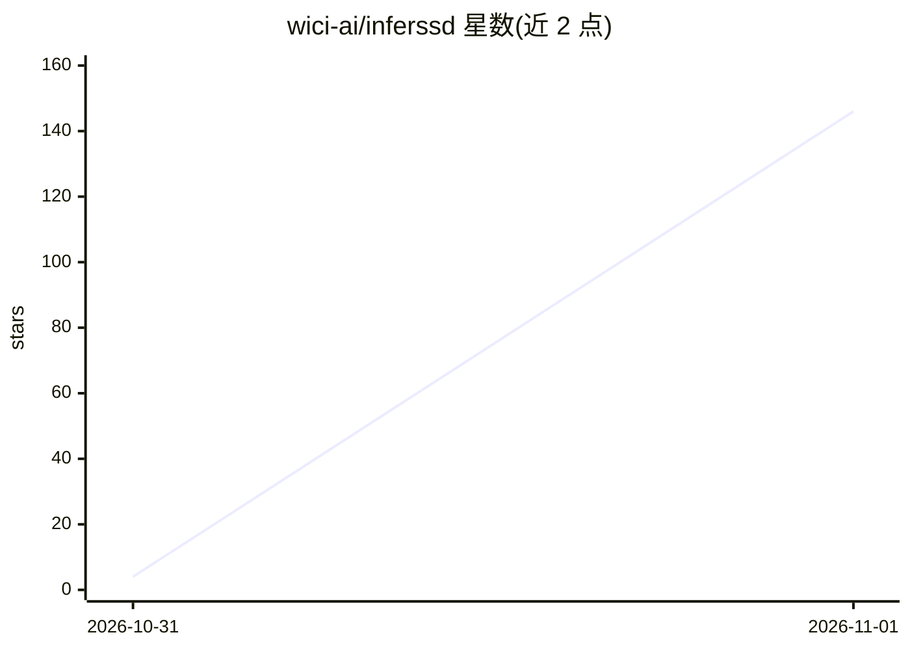

# wici-ai/inferssd

⭐ 146 · C++ · Apache-2.0 · 推送 2026-10-31 · [GitHub](https://github.com/wici-ai/inferssd) · [官网](https://wici.ai/inferssd) · 组织维护

**从 SSD 流式加载 MoE 专家的推理引擎，可跑超内存大模型**

基于 llama.cpp/ggml 构建的推理运行时，将 MoE 模型的专家权重存放于 SSD 并按需流式加载，使总参数量超过 RAM/VRAM 的模型在消费级与工作站硬件上运行。使用标准 GGUF 文件，目前测试支持 DeepSeek-V4.1-Flash-1017（763B）与 Muse-Spark-Open（816B），提供终端聊天、浏览器 Web UI 与 OpenAI 兼容 API。通过脚本从源码编译安装（约 2-12 分钟），尚无预编译包；支持 macOS/Metal 与 Linux/CUDA，Windows 开发中。首次运行下载约 470 GiB 模型文件。

## 筛选速览

| 维度 | 判定 | 备注 |
|---|---|---|
| AI 角色 | `ai-ecosystem` | LLM/agent 周边工具 |
| 许可风险 | `permissive` | Apache-2.0 |
| 部署形态 | `None` |  |
| 模型依赖 | — | README 未给出锁定关系 |
| 硬件要求 | — | 无带数字的原话,不猜 |
| 安装摩擦 | `medium` | 含编译或系统依赖之一 |
| 成熟度 | `idea` | |

## 能力要点

- SSD 流式加载 MoE 专家，运行超过 RAM/VRAM 的模型
- 标准 GGUF 文件，OpenAI 兼容 API 与浏览器聊天界面
- 无内存配置项，自动使用可用内存
- macOS/Metal 与 Linux/CUDA 支持，Windows 进行中

## 适用场景

- 在 48GB MacBook Pro 或 8GB 显存显卡上运行 700B+ 参数 MoE 模型
- 通过 OpenAI 兼容 API 在本地服务大模型
- 对比 llama.cpp 在大 MoE 模型上的推理吞吐

## 场景标签

`推理引擎` · 领域:训练与推理

## 证据(README 行号)

> L14: **Run models larger than your RAM or VRAM.** InferSSD builds on llama.cpp to run large mixture-of-experts (MoE) mod
> L99: Built on llama.cpp and ggml, with thanks to their contributors and the model-adaptation community.

## 星数曲线

2026-10-31 4 → 2026-11-01 146（+142）

---
*卡片 v1 · prompt 1.4 · 生成 2026-10-31 · 置信度 high · 依据 README sha `5865d7f1440e` · [字段定义](../../DATASET.md)*
