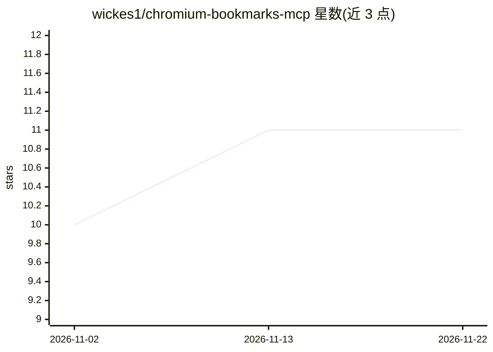

# wickes1/chromium-bookmarks-mcp

⭐ 11 · TypeScript · MIT · 推送 2026-11-19 · [GitHub](https://github.com/wickes1/chromium-bookmarks-mcp) · 个人维护

**让 AI agent 实时读写浏览器书签的 MCP 服务器**

由 Chrome 扩展、本地 native host 与 MCP stdio 代理组成的三进程架构，通过 MCP 协议向 Claude、Cursor、Windsurf 等 MCP 客户端开放 19 个书签工具，覆盖读取、写入、批量操作、Netscape HTML 导入导出与死链检测；破坏性操作带 dry_run 预览与 confirm 确认门控。需 Bun 1.2+ 与常开的 Chromium 系浏览器（Chrome/Brave/Edge/Arc），通信仅限本机 localhost，删除操作不可撤销。

## 筛选速览

| 维度 | 判定 | 备注 |
|---|---|---|
| AI 角色 | `ai-ecosystem` | LLM/agent 周边工具 |
| 许可风险 | `permissive` | MIT |
| 部署形态 | `library` | 以包/库形式分发 |
| 模型依赖 | — | README 未给出锁定关系 |
| 硬件要求 | — | 无带数字的原话,不猜 |
| 安装摩擦 | `low` | 无编译、无系统依赖或容器化 |
| 成熟度 | — | 结构信号不足 |

## 能力要点

- 19 个 MCP 工具覆盖书签增删改查、批量去重与文件夹合并
- Netscape Bookmark HTML 导出/导入作为备份与恢复手段
- 破坏性操作需 dry_run 预览并 confirm: true 确认
- 仅 3 项扩展权限，通信限于 127.0.0.1，无遥测

## 适用场景

- 让 Claude/Cursor 等 AI 客户端代为整理、去重、分类书签
- 批量清理书签前先导出 HTML 备份
- 检测书签中的失效链接

## 场景标签

`浏览器自动化` · 领域:效率与自动化

## 证据(README 行号)

> L5:  Give AI agents real-time read/write access to your browser bookmarks via Model Context Protocol.
> L12:  Works with Claude Code &middot; Claude Desktop &middot; Cursor &middot; Windsurf &middot; VS Code Copilot &middot;

## 星数曲线

2026-11-02 10 → 2026-11-22 11（+1）

---
*卡片 v1 · prompt 1.4 · 生成 2026-11-18 · 置信度 high · 依据 README sha `b080810e8e15` · [字段定义](../../DATASET.md)*
