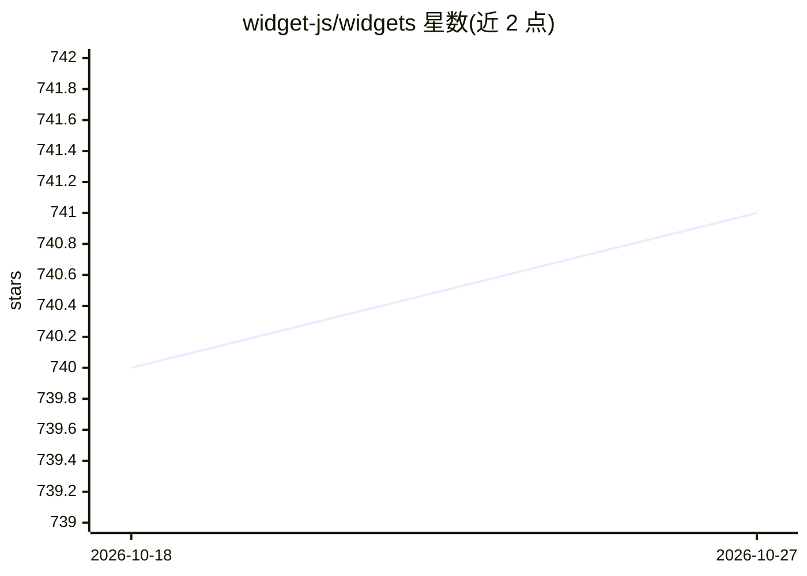

# widget-js/widgets

⭐ 741 · TypeScript · 推送 2026-09-28 · [GitHub](https://github.com/widget-js/widgets) · [官网](https://widget-js.github.io/widgets/#/) · 组织维护 · 中文 README

**Windows 桌面组件应用：内置多种小组件并支持 AI 生成新组件**

基于 React 构建的 Windows 桌面组件集合（Widget Hub），内置 Chat、bilibili、discord、剪贴板历史、时钟、倒计时、待办、提醒等组件，提供在线预览页面浏览全部组件。AI 部分：通过 npx 安装 widget-js/skills 技能并在 AI 编码工具（Claude Code、Trae、Codex 等）中配置 MCP Server，用户输入自然语言提示即可生成自定义桌面组件，依赖 Node.js 与 WidgetHub Desktop Client。

## 筛选速览

| 维度 | 判定 | 备注 |
|---|---|---|
| AI 角色 | `ai-enhanced` | 去掉 AI 部分产品仍成立 |
| 许可风险 | `none` | — |
| 部署形态 | `library` | 以包/库形式分发 |
| 模型依赖 | — | README 未给出锁定关系 |
| 硬件要求 | — | 无带数字的原话,不猜 |
| 安装摩擦 | `low` | 无编译、无系统依赖或容器化 |
| 成熟度 | — | 结构信号不足 |

## 能力要点

- 内置 Chat、bilibili、discord、剪贴板历史、时钟、待办等桌面组件
- 通过 npx 安装 skill 并配置 MCP Server，用自然语言生成自定义组件
- 提供在线页面预览全部组件

## 适用场景

- 在 Windows 桌面使用时钟、待办、剪贴板历史等小组件
- 用 AI 编码工具按提示词生成自定义桌面组件
- 通过网页预览浏览可用组件

## 场景标签

`代码生成` · 领域:编码与开发

## 证据(README 行号)

> L4:  Widgets - Capable and ergonomic widgets.
> L22: ## 🤖 Generate Desktop Widgets with AI

## 星数曲线

2026-10-18 740 → 2026-10-27 741（+1）

---
*卡片 v1 · prompt 1.4 · 生成 2026-10-21 · 置信度 mid · 依据 README sha `693fdd23f5fe` · [字段定义](../../DATASET.md)*
