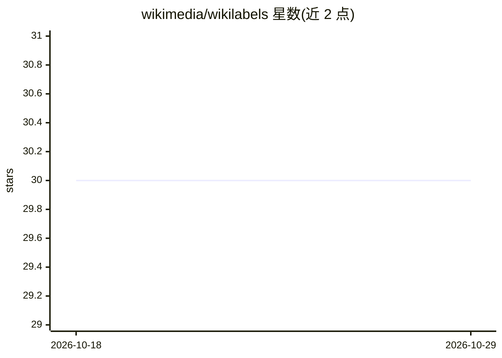

# wikimedia/wikilabels

⭐ 30 · JavaScript · MIT · 推送 2026-10-19 · [GitHub](https://github.com/wikimedia/wikilabels) · [官网](https://meta.wikimedia.org/wiki/Wiki_labels) · 组织维护

**MediaWiki 通用标注服务：为众包标注任务提供前端脚本与 Flask 服务器**

Wikimedia 维护的通用标注服务，包含两个组件：部署在 MediaWiki 上的用户脚本（供标注者使用的前端 gadget）和与之通信的 Flask 服务器。服务器使用 PostgreSQL 存储任务与标注数据，支持 memcached，通过命令行工具加载 schema、创建标注活动（campaign）并按 json-lines 格式插入任务数据。标注任务可自定义展示视图（如 MultiDiffToPrevious），文档中讨论了如何通过隐藏编辑者用户名、时间戳等信息减少标注偏差。需自行安装 postgresql、npm 等系统依赖并配置数据库。

## 筛选速览

| 维度 | 判定 | 备注 |
|---|---|---|
| AI 角色 | `ai-ecosystem` | LLM/agent 周边工具 |
| 许可风险 | `permissive` | MIT |
| 部署形态 | `None` |  |
| 模型依赖 | — | README 未给出锁定关系 |
| 硬件要求 | — | 无带数字的原话,不猜 |
| 安装摩擦 | `medium` | 含编译或系统依赖之一 |
| 成熟度 | — | 结构信号不足 |

## 能力要点

- 用户脚本 + Flask 服务器的双组件标注架构
- 支持自定义标注视图（需实现 .load 与 .present）
- campaign 式任务管理，json-lines 格式批量插入任务数据
- 文档包含减少标注偏差的视图设计讨论（如盲化编辑者用户名）

## 适用场景

- 在 wiki 站点上组织众包标注活动（如编辑质量评估）
- 为机器学习模型训练收集人工标注数据
- 自定义标注界面并批量导入待标注任务

## 场景标签

 · 领域:数据标注/众包

## 证据(README 行号)

> L5: This package provides the components of a generalized labeling service for
> L6: MediaWiki. There are two primary components, a user script to be used on

## 星数曲线

2026-10-18 30 → 2026-10-29 30（+0）

---
*卡片 v1 · prompt 1.4 · 生成 2026-10-26 · 置信度 mid · 依据 README sha `2dfbbf5523c9` · [字段定义](../../DATASET.md)*
