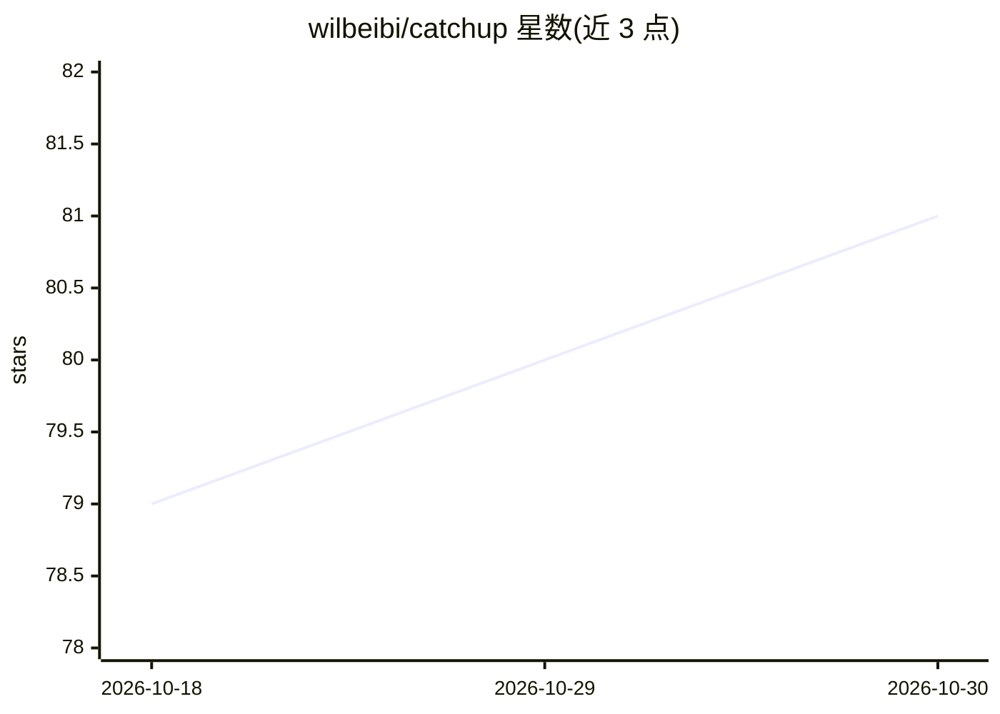

# wilbeibi/catchup

⭐ 81 · Go · MIT · 推送 2026-10-24 · [GitHub](https://github.com/wilbeibi/catchup) · [官网](https://catchup.pages.dev/) · 个人维护

**本地 CLI：在多个 AI 编程 agent 间迁移与恢复会话上下文**

本地优先的命令行工具，读取 14 种 AI 编程 agent（Claude Code、Codex、Cursor、Cline、Kimi 等）的本地会话记录并转为 Markdown，支持按关键词/ID 搜索历史会话；`catchup fork` 可在同 agent 内用原生恢复路径继续，或以 `--into` 将转录注入另一 agent 续做。工具只读（fork 除外），不合并历史，跨 agent fork 仅传递转录而非原生会话状态；Amp、Kimi、ZCode、DeepSeek Harness 不能作为交互式启动目标。经 Homebrew 或 Windows 二进制安装。

## 筛选速览

| 维度 | 判定 | 备注 |
|---|---|---|
| AI 角色 | `ai-ecosystem` | LLM/agent 周边工具 |
| 许可风险 | `permissive` | MIT |
| 部署形态 | `desktop` | 安装包/桌面程序 |
| 模型依赖 | — | README 未给出锁定关系 |
| 硬件要求 | — | 无带数字的原话,不猜 |
| 安装摩擦 | `low` | 无编译、无系统依赖或容器化 |
| 成熟度 | — | 结构信号不足 |

## 能力要点

- 读取 14 种编程 agent 的本地会话并转为 Markdown
- fork --into 跨 agent 交接会话上下文（如 Claude Code → Codex）
- 按关键词/ID 搜索多项目多 agent 的历史会话
- 配额可见性：statusline 显示与 Codex 轮末提醒

## 适用场景

- agent 用量达限时，把会话交给另一个 agent 继续
- 中途换工具时不再向新 agent 重复解释任务
- 按关键词找回旧会话并干净地恢复工作

## 场景标签

 · 领域:开发者工具/AI 编程 agent

## 证据(README 行号)

> L7: `catchup` is a local-first CLI that hands off session context between AI coding agents. It reads a local session int
> L11: Works with **Claude Code**, **Codex**, **Copilot CLI**, **Cursor**, **Cline**, **Kimi**, **Antigravity**, **OpenCod
> L44: Agents: `claude` · `codex` · `copilot` · `cursor` · `cline` · `kimi` · `agy` (Antigravity) · `opencode` · `pi-agent

## 星数曲线

2026-10-18 79 → 2026-10-30 81（+2）

---
*卡片 v1 · prompt 1.4 · 生成 2026-10-24 · 置信度 high · 依据 README sha `194f980dadfc` · [字段定义](../../DATASET.md)*
