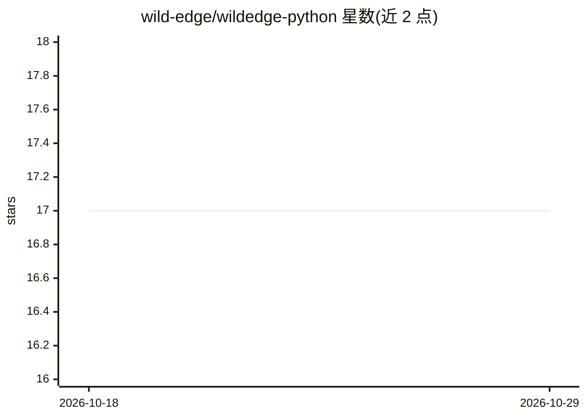

# wild-edge/wildedge-python

⭐ 17 · Python · NOASSERTION · 推送 2026-10-27 · [GitHub](https://github.com/wild-edge/wildedge-python) · [官网](https://wildedge.dev) · 组织维护

**监控本地与远程 ML 推理的 Python 可观测性 SDK**

面向 Python 开发者的推理监控 SDK：跟踪延迟、token 用量、错误、模型元数据与本地硬件上下文（温度、加速器使用、CPU 节流），支持 llama.cpp、Transformers、MLX-LM、ONNX Runtime、PyTorch 等本地推理库及 OpenAI/Anthropic 等 API 客户端的自动插桩，一条 `wildedge run` 命令即可接入，也可在代码中手动埋点并组织 trace/span。事件发送到 app.wildedge.dev 需 DSN，未设置时为静默空操作；默认不上传原始输入输出。

## 筛选速览

| 维度 | 判定 | 备注 |
|---|---|---|
| AI 角色 | `ai-ecosystem` | LLM/agent 周边工具 |
| 许可风险 | `none` | NOASSERTION |
| 部署形态 | `library` | 以包/库形式分发 |
| 模型依赖 | — | README 未给出锁定关系 |
| 硬件要求 | — | 无带数字的原话,不猜 |
| 安装摩擦 | `low` | 无编译、无系统依赖或容器化 |
| 成熟度 | — | 结构信号不足 |

## 能力要点

- 对 llama.cpp/Transformers/MLX/ONNX Runtime 等本地推理库自动插桩
- 追踪工作流 trace/span，跨本地与云端模型
- 采集本地硬件上下文（热状态、加速器、CPU 节流）
- 无 DSN 时静默空操作；原始输入输出仅在显式启用后上传

## 适用场景

- 监控本地大模型推理的延迟、吞吐与错误
- 追踪混合本地/云端 LLM 工作流的耗时分布
- 在 CI 与开发环境中零配置收集推理事件

## 场景标签

 · 领域:AI 可观测性/开发者工具

## 证据(README 行号)

> L11: Monitor local and remote ML inference from Python. Track latency, token usage,
> L15: Instrument supported libraries with one command, or add tracking in your code.

## 星数曲线

2026-10-18 17 → 2026-10-29 17（+0）

---
*卡片 v1 · prompt 1.4 · 生成 2026-10-29 · 置信度 high · 依据 README sha `c07a39471d89` · [字段定义](../../DATASET.md)*
