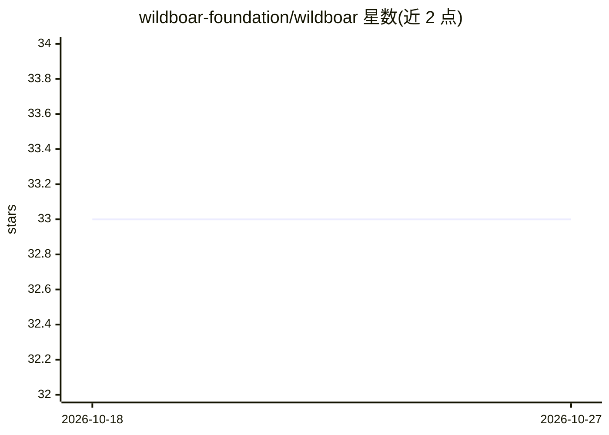

# wildboar-foundation/wildboar

⭐ 33 · Python · BSD-3-Clause · 推送 2026-10-26 · [GitHub](https://github.com/wildboar-foundation/wildboar) · [官网](https://wildboar.dev) · 个人维护

**时间序列机器学习 Python 库：分类/回归/解释与快速距离计算**

基于 scikit-learn 和 numpy 构建的时间序列机器学习库，BSD 3-Clause 许可，由 Isak Samsten 维护。提供 Shapelet 森林、Rocket、区间森林、近邻等分类与回归模型，反事实解释与特征重要性分析，UCR-suite、MASS、DTW 及多种弹性距离度量，以及 KMeans/KMedoids 聚类、矩阵档案变换等无监督功能。pip 安装提供 Python 3.10-3.12 的 Linux/Windows/macOS 预编译二进制，也可从源码编译（需 numpy、scikit-learn、scipy、cython）。

## 筛选速览

| 维度 | 判定 | 备注 |
|---|---|---|
| AI 角色 | `ai-native` | 本体是模型或模型工具 |
| 许可风险 | `permissive` | BSD-3-Clause |
| 部署形态 | `library` | 以包/库形式分发 |
| 模型依赖 | — | README 未给出锁定关系 |
| 硬件要求 | — | 无带数字的原话,不猜 |
| 安装摩擦 | `low` | 无编译、无系统依赖或容器化 |
| 成熟度 | — | 结构信号不足 |

## 能力要点

- Shapelet/Rocket/区间森林等时间序列分类与回归模型族
- 反事实解释与 Shapelet/区间重要性等可解释性方法
- UCR-suite、MASS、DTW 及 LCSS/TWE/ERP 等多种距离度量
- KMeans(K)Medoids 聚类、矩阵档案与 motif 发现等无监督功能

## 适用场景

- 对时间序列数据做分类或回归建模
- 分析模型预测所依赖的区间与 shapelet 特征
- 使用 DTW 等弹性距离做聚类或近邻检索

## 场景标签

`数据分析` · 领域:效率与自动化

## 证据(README 行号)

> L5: wildboar is a Python module for temporal machine learning and fast
> L16: |Repositories|`ShapeletForestClassifier`|`ShapeletForestRegressor`|`ShapeletForestCounterfactual`|UCR-suite|`Shapel

## 星数曲线

2026-10-18 33 → 2026-10-27 33（+0）

---
*卡片 v1 · prompt 1.4 · 生成 2026-10-25 · 置信度 high · 依据 README sha `2878c5e08594` · [字段定义](../../DATASET.md)*
