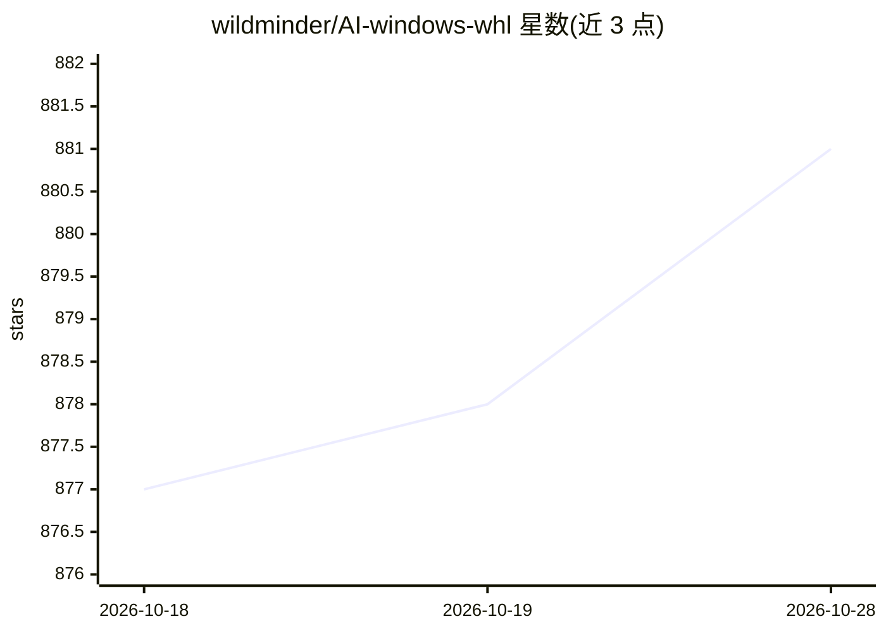

# wildminder/AI-windows-whl

⭐ 881 · 推送 2026-09-07 · [GitHub](https://github.com/wildminder/AI-windows-whl) · [官网](https://wildminder.github.io/AI-windows-whl/) · 个人维护

**Windows 平台 AI/ML 库预编译 whl 链接清单，免源码编译**

面向 Windows 用户（主要为 ComfyUI 社区与 PyTorch 用户）的预编译 Python wheel 链接策展仓库：收录 flash-attention、xformers、SageAttention、NATTEN、Triton、bitsandbytes、torchaudio 等在 Windows 上缺乏官方预构建包的库，按包版本、PyTorch 版本、Python 版本、CUDA 版本与 CXX11 ABI 列出直链，用 pip install 加 URL 安装。另提供网页版查找工具 Find Windows AI Wheels。仓库本身是链接目录，不含二进制构建流程，PyTorch 部分转引官方安装命令。

## 筛选速览

| 维度 | 判定 | 备注 |
|---|---|---|
| AI 角色 | `ai-knowledge` | 知识聚合/清单类 |
| 许可风险 | `none` | — |
| 部署形态 | `library` | 以包/库形式分发 |
| 模型依赖 | — | README 未给出锁定关系 |
| 硬件要求 | — | 无带数字的原话,不猜 |
| 安装摩擦 | `medium` | 含编译或系统依赖之一 |
| 成熟度 | — | 结构信号不足 |

## 能力要点

- 按 PyTorch/Python/CUDA 版本与 CXX11 ABI 组织的 whl 直链表
- 覆盖 flash-attention（含 FA3）、xformers、SageAttention、NATTEN、bitsandbytes 等库
- 提供网页版 Find Windows AI Wheels 查找页
- 附 PyTorch 各版本官方 pip 安装命令（CUDA 11.8–13.2）

## 适用场景

- 在 Windows 上免源码编译安装 flash-attention 等库
- 为 ComfyUI 环境匹配对应 CUDA/PyTorch 版本的预编译包
- 查找特定 Python 版本可用的 wheel 组合

## 场景标签

`精选清单` · 领域:学习与行业

## 证据(README 行号)

> L5:  A curated collection of pre-compiled Python wheels for difficult-to-install AI/ML libraries on Windows.
> L43: This repository was created to address a common pain point for AI enthusiasts and developers on the Windows platfor
> L45: The goal here is to provide a centralized, up-to-date collection of direct links to pre-compiled `.whl` files for t

## 星数曲线

2026-10-18 877 → 2026-10-28 881（+4）

---
*卡片 v1 · prompt 1.4 · 生成 2026-10-21 · 置信度 high · 依据 README sha `2ce12092d9e1` · [字段定义](../../DATASET.md)*
