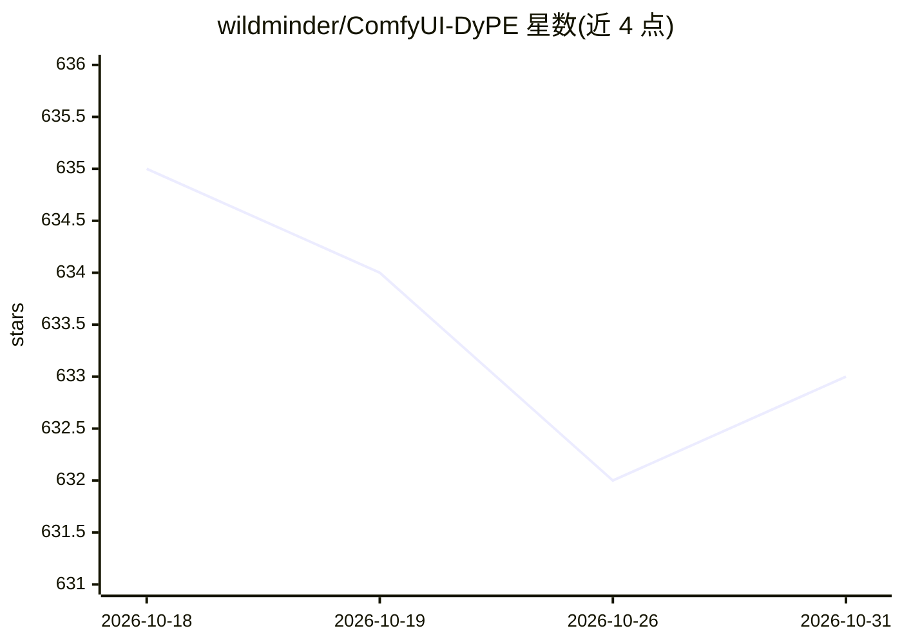

# wildminder/ComfyUI-DyPE

⭐ 633 · Python · Apache-2.0 · 推送 2026-10-24 · [GitHub](https://github.com/wildminder/ComfyUI-DyPE) · 个人维护

**ComfyUI 节点包：让 FLUX/Qwen/Z-Image 等 DiT 生成 4K 以上图像**

面向 ComfyUI 的自定义节点包，通过免训练的模型补丁方法将预训练 Diffusion Transformer 推进到原生分辨率之上（2K/4K 及更高）。提供八类节点：模型补丁类（DyPE 动态位置外推、SEGA 频谱能量注意力锐化、SPA 空间位置对齐、HAP 稀疏注意力加速、I-Max 双通道外推）作用于采样过程；级联类（PixelRush、FreeScale、HiFlow）消费已有图像做放大精修。支持 FLUX、Nunchaku、Qwen-Image 1.0/2.1、Krea-2、Z-Image、Anima/Cosmos 等架构，SPA 与 DyPE/SEGA 互斥，Nunchaku 不支持 SPA/HAP。

## 筛选速览

| 维度 | 判定 | 备注 |
|---|---|---|
| AI 角色 | `ai-ecosystem` | LLM/agent 周边工具 |
| 许可风险 | `permissive` | Apache-2.0 |
| 部署形态 | `None` |  |
| 模型依赖 | — | README 未给出锁定关系 |
| 硬件要求 | — | 无带数字的原话,不猜 |
| 安装摩擦 | `medium` | 含编译或系统依赖之一 |
| 成熟度 | — | 结构信号不足 |

## 能力要点

- DyPE 免训练位置编码外推，支持 4096×4096 及以上分辨率
- 八类高分辨率节点，覆盖原生高-res 生成与已有图像级联放大两类方法
- 多架构支持：FLUX、Nunchaku、Qwen-Image 1.0/2.1、Krea-2、Z-Image、Anima/Cosmos
- SPA 修复高分辨率下的重复/塌缩结构，HAP 提供 1.3-1.8× 推理开销内的加速选项

## 适用场景

- 用 FLUX 或 Qwen-Image 工作流直接生成 4K 分辨率图像
- 修复高分辨率生成中的重复结构与位置错乱
- 对已有图像做结构保持的高分辨率级联放大
- 降低长序列高分辨率推理的注意力开销

## 场景标签

`图像生成` · 领域:内容生成

## 证据(README 行号)

> L5: ComfyUI custom node pack for ultra-high-resolution generation (4K and beyond) with Diffusion Transformers — FLUX , Q
> L15: Training-free methods that push pre-trained DiT models far beyond their native resolution — no retraining, no workf

## 星数曲线

2026-10-18 635 → 2026-10-31 633（-2）

---
*卡片 v1 · prompt 1.4 · 生成 2026-10-21 · 置信度 high · 依据 README sha `39ec8ceca002` · [字段定义](../../DATASET.md)*
