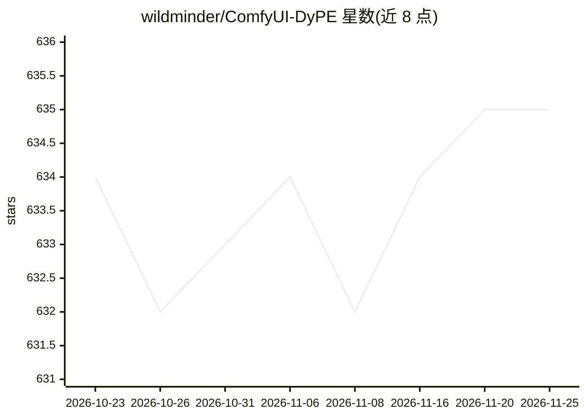

# wildminder/ComfyUI-DyPE

⭐ 635 · Python · Apache-2.0 · 推送 2026-10-24 · [GitHub](https://github.com/wildminder/ComfyUI-DyPE) · 个人维护

**ComfyUI 节点包：DiT 模型免训练生成 4K+ 图像**

面向 ComfyUI 的自定义节点包，提供 DyPE、SEGA、SPA、HAP、PixelRush、FreeScale、HiFlow、I-Max、AReA 等节点，通过位置编码外推、频谱锐化、注意力对齐等方式，使 FLUX、Qwen Image、Z-Image、Krea-2、Anima/Cosmos 等 DiT 模型在原生分辨率之上生成 2K/4K 及以上图像，无需重训练。节点置于模型加载器之后即可使用；SPA 与 DyPE/SEGA 互斥，Nunchaku 部分方法不支持。安装方式为源码方式（见安装说明）。

## 筛选速览

| 维度 | 判定 | 备注 |
|---|---|---|
| AI 角色 | `ai-native` | 本体是模型或模型工具 |
| 许可风险 | `permissive` | Apache-2.0 |
| 部署形态 | `None` |  |
| 模型依赖 | — | README 未给出锁定关系 |
| 硬件要求 | — | 无带数字的原话,不猜 |
| 安装摩擦 | `medium` | 含编译或系统依赖之一 |
| 成熟度 | — | 结构信号不足 |

## 能力要点

- 9 个节点覆盖原生高分辨率生成与级联放大两条路径
- 支持 FLUX、Qwen Image 1.0/2.1、Z-Image、Krea-2、Anima/Cosmos 等架构
- 单节点接入，置于模型加载器后即可使用，兼容现有工作流
- 免训练，运行时动态调整，SPA 在 ≤1024px 时自动 no-op

## 适用场景

- 在 ComfyUI 中用 FLUX/Qwen 等模型直接从噪声生成 4K 图像
- 对已有图片做保真放大或重绘式高分辨率重构
- 修复高分辨率下的重复/坍塌结构并加速采样

## 场景标签

`图像生成` · 领域:内容生成

## 证据(README 行号)

> L5: ComfyUI custom node pack for ultra-high-resolution generation (4K and beyond) with Diffusion Transformers — FLUX , Q
> L15: Training-free methods that push pre-trained DiT models far beyond their native resolution — no retraining, no workf

## 星数曲线

2026-10-23 634 → 2026-11-25 635（+1）

---
*卡片 v1 · prompt 1.4 · 生成 2026-11-24 · 置信度 high · 依据 README sha `6318389ff41b` · [字段定义](../../DATASET.md)*
