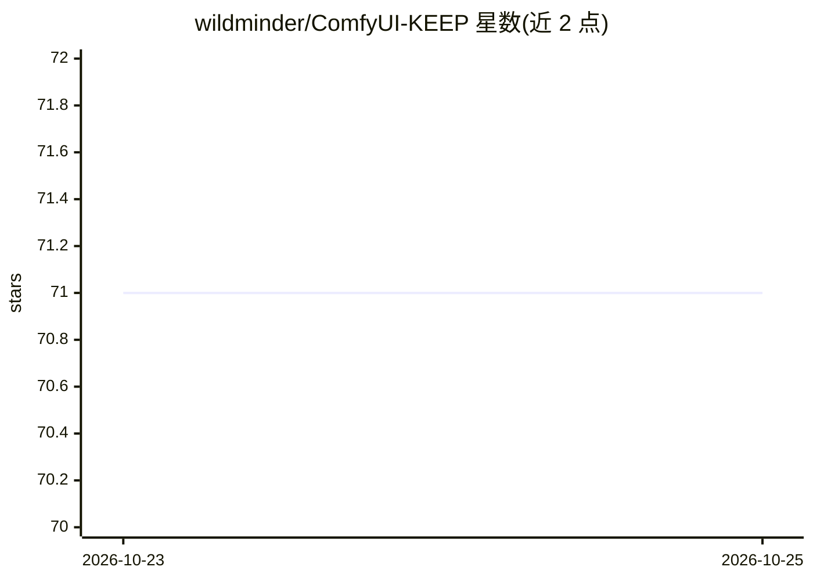

# wildminder/ComfyUI-KEEP

⭐ 71 · Python · Apache-2.0 · 推送 2026-10-20 · [GitHub](https://github.com/wildminder/ComfyUI-KEEP) · 个人维护

**ComfyUI 上的 KEEP 视频人脸超分辨率自定义节点**

为 ComfyUI 提供实现 KEEP 算法（Kalman 启发特征传播）的自定义节点，用于视频帧序列与单张图像的人脸修复与超分辨率。包含三个节点：Load KEEP Models（加载 KEEP 主模型与人脸检测模型，支持接入标准 Upscale Model Loader 的放大模型）、KEEP Single Image、KEEP Image Sequence（支持 max_clip_length 控制 VRAM 占用）。提供通用与 Asian 两种模型，人脸检测可选 RetinaFace、YOLOv5 等骨干，支持多脸处理与跟踪。通过 git clone 到 custom_nodes 目录并 pip 安装依赖使用，模型首次运行自动下载，失败可手动下载。核心算法与模型来自原 KEEP 项目（ECCV 2024 论文）。

## 筛选速览

| 维度 | 判定 | 备注 |
|---|---|---|
| AI 角色 | `ai-native` | 本体是模型或模型工具 |
| 许可风险 | `permissive` | Apache-2.0 |
| 部署形态 | `library` | 以包/库形式分发 |
| 模型依赖 | — | README 未给出锁定关系 |
| 硬件要求 | — | 无带数字的原话,不猜 |
| 安装摩擦 | `low` | 无编译、无系统依赖或容器化 |
| 成熟度 | — | 结构信号不足 |

## 能力要点

- 实现 KEEP 算法的视频人脸超分辨率，支持单图与帧序列处理
- 2025-07 更新支持多脸处理与跟踪
- 可接入任意 ComfyUI 兼容放大模型，背景与人脸可用不同模型
- final_upscale_factor 精确控制输出尺寸；max_clip_length 用于显存管理

## 适用场景

- 在 ComfyUI 工作流中修复和增强视频帧中的人脸
- 对低分辨率单张人像照片做人脸修复与放大
- 在视频修复流程中分别对人脸与背景使用不同的放大模型

## 场景标签

`图像视频处理` · 领域:感知与多模态

## 证据(README 行号)

> L15: This repository provides custom nodes for ComfyUI that implement the **KEEP** algorithm for face super-resolution. 
> L25: * **High-Quality Face Restoration:** Utilizes the core KEEP model for detailed face enhancement.

## 星数曲线

2026-10-23 71 → 2026-10-25 71（+0）

---
*卡片 v1 · prompt 1.4 · 生成 2026-10-24 · 置信度 mid · 依据 README sha `b8a312058278` · [字段定义](../../DATASET.md)*
