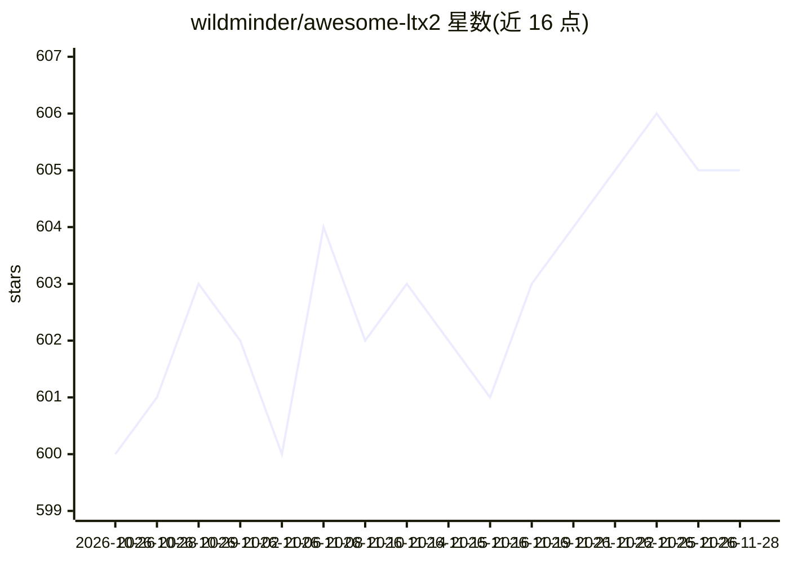

# wildminder/awesome-ltx2

⭐ 605 · 推送 2026-11-13 · [GitHub](https://github.com/wildminder/awesome-ltx2) · 个人维护

**LTX-2 视频生成模型、编码器、工作流与 LoRA 的策展清单**

面向 ComfyUI 用户的 LTX-2 视频生成资源聚合清单：收录官方与社区权重的 checkpoint（bf16/fp8/int8/nvfp4/GGUF 等量化格式，附文件大小与下载链接）、文本编码器、VAE、LoRA、桌面工具与 ComfyUI 节点包，并含 LTX-2 视频水印标记（PixelSeal/AudioSeal）的权重说明与加载参数。条目以分类目录组织，指向 HuggingFace/GitHub 下载源。本仓库本身不训练、不推理，仅做资源编目与下载指引。

## 筛选速览

| 维度 | 判定 | 备注 |
|---|---|---|
| AI 角色 | `ai-knowledge` | 知识聚合/清单类 |
| 许可风险 | `none` | — |
| 部署形态 | `None` |  |
| 模型依赖 | — | README 未给出锁定关系 |
| 硬件要求 | — | 无带数字的原话,不猜 |
| 安装摩擦 | `low` | 无编译、无系统依赖或容器化 |
| 成熟度 | — | 结构信号不足 |

## 能力要点

- 汇总 LTX-2/2.3/2.5 各版本、多精度量化 checkpoint 的下载清单
- 收录低显存桌面工具与节点包（最低 6–24 GB VRAM 的使用说明）
- 包含 PixelSeal/AudioSeal 隐形水印权重的配置与启用方法
- 附带 WanGP 用的约 984 GB 预打包完整模型包说明

## 适用场景

- 为 ComfyUI 搭建 LTX-2 视频生成环境时下载对应量化权重
- 按自己的显存大小挑选合适的模型版本与工具
- 查找 LTX-2 相关 LoRA 与文本编码器资源

## 场景标签

`精选清单` `视频生成` · 领域:内容生成

## 证据(README 行号)

> L1: # Awesome LTX-2
> L3: A curated list of models, text encoders, and tools for the LTX-2 video generation suite.
> L82: ## ▓ Models

## 星数曲线

2026-10-26 600 → 2026-11-28 605（+5）

---
*卡片 v1 · prompt 1.4 · 生成 2026-11-25 · 置信度 high · 依据 README sha `d2a4a71ccfcc` · [字段定义](../../DATASET.md)*
