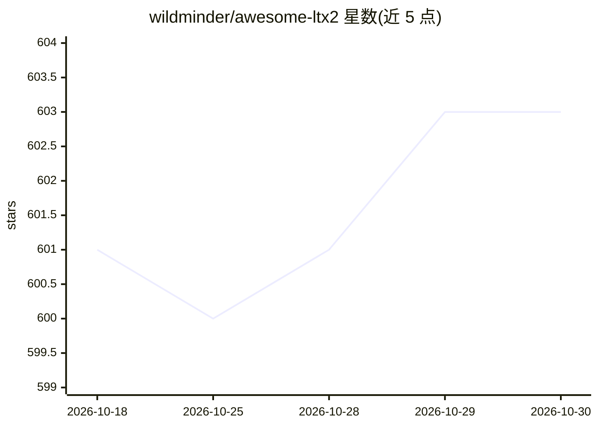

# wildminder/awesome-ltx2

⭐ 603 · 推送 2026-10-27 · [GitHub](https://github.com/wildminder/awesome-ltx2) · 个人维护

**LTX-2 视频生成模型的策展清单：模型/编码器/工具/LoRA 汇总**

面向 LTX-2 视频生成套件用户的策展清单：收录官方与第三方 checkpoint（含 bf16/fp8/int8/nvfp4/GGUF 等量化格式，附下载链接与体积）、文本编码器（Gemma 系列）、LoRA 集合及配套工具应用（LTX 桌面版、WanGP 模型包、ComfyUI 训练节点包等），面向 ComfyUI 与 diffusers 使用场景组织，条目多托管于 Hugging Face。

## 筛选速览

| 维度 | 判定 | 备注 |
|---|---|---|
| AI 角色 | `ai-knowledge` | 知识聚合/清单类 |
| 许可风险 | `none` | — |
| 部署形态 | `None` |  |
| 模型依赖 | — | README 未给出锁定关系 |
| 硬件要求 | — | 无带数字的原话,不猜 |
| 安装摩擦 | `low` | 无编译、无系统依赖或容器化 |
| 成熟度 | — | 结构信号不足 |

## 能力要点

- 收录 LTX-2/2.3/2.5 各版本 dev/distilled checkpoint 及多种量化格式（fp8/int8/nvfp4/GGUF 等）
- 汇总社区量化作者（Drbaph、unsloth 等）与官方 Lightricks 权重的下载链接
- 包含 LTX2.3 桌面版、WanGP 低显存模型包（约 984 GB）、Int4 LoRA 训练节点包等工具条目
- 覆盖 IC-LoRA、ID-LoRA、控制类 LoRA 及文本编码器与 VAE 等组件

## 适用场景

- 查找 LTX-2 各版本与量化格式的可下载权重
- 为 ComfyUI 或 WanGP 配置 LTX-2 运行环境挑选模型与 LoRA
- 了解 LTX-2 生态中的社区工具与量化变体

## 场景标签

`精选清单` · 领域:学习与行业

## 证据(README 行号)

> L3: A curated list of models, text encoders, and tools for the LTX-2 video generation suite.
> L68: LTX-2 models are available in various formats including full weights, transformers-only, and GGUF quantizations for

## 星数曲线

2026-10-18 601 → 2026-10-30 603（+2）

---
*卡片 v1 · prompt 1.4 · 生成 2026-10-21 · 置信度 high · 依据 README sha `8d07e5c20e0c` · [字段定义](../../DATASET.md)*
