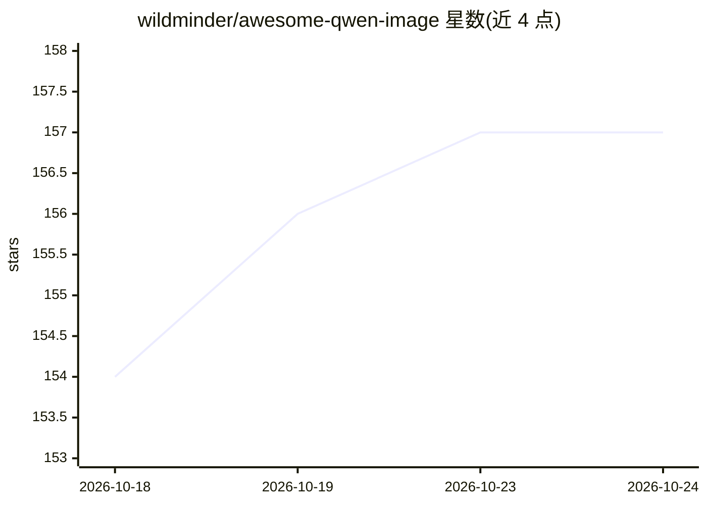

# wildminder/awesome-qwen-image

⭐ 157 · 推送 2026-10-19 · [GitHub](https://github.com/wildminder/awesome-qwen-image) · 个人维护 · 中文 README

**Qwen-Image 2.1 模型资源策展清单：权重、量化、提示引擎与工具**

面向使用 Qwen-Image 2.1（阿里 7B 文生图/图像编辑统一模型）用户的 curated list：收录官方与社区 checkpoints（含 Turbo 8 步版本）、多精度量化（BF16/int8/Q4_K_M 等 GGUF 与 ConvRot 格式）、提示改写模型（PE-T2I/PE-I2I 及 Pocket 小模型）、LoRA、ControlNet 与 ComfyUI 预拆分文件。按运行时（Diffusers、ComfyUI、llama.cpp、MLX）给出选型表格，标注文件尺寸、目录摆放与许可（Qwen Research License）。含 abliterated/Heretic 变体并附安全警示。

## 筛选速览

| 维度 | 判定 | 备注 |
|---|---|---|
| AI 角色 | `ai-knowledge` | 知识聚合/清单类 |
| 许可风险 | `none` | — |
| 部署形态 | `None` |  |
| 模型依赖 | — | README 未给出锁定关系 |
| 硬件要求 | — | 无带数字的原话,不猜 |
| 安装摩擦 | `medium` | 含编译或系统依赖之一 |
| 成熟度 | — | 结构信号不足 |

## 能力要点

- 按运行时（Diffusers/ComfyUI/llama.cpp-GGUF/MLX）组织的选型表格
- 覆盖官方权重、Turbo checkpoint、int4/ConvRot/GGUF 量化与 Prompt Engine（含 2B/0.8B Pocket 版）
- ComfyUI 预拆分文件的目录摆放说明与 ConvRot 格式说明
- 含 Heretic/abliterated 变体并附许可与安全警示

## 适用场景

- 挑选适合自己显存与运行时的 Qwen-Image 2.1 权重与量化版本
- 查找官方 Turbo 少步生成 checkpoint 与 ComfyUI 预拆分文件
- 选择提示改写模型（PE-T2I/PE-I2I）提升出图提示质量

## 场景标签

`精选清单` `图像生成` · 领域:内容生成

## 证据(README 行号)

> L3: A curated list of checkpoints, quants, prompt engines, LoRAs, and tooling for **Qwen-Image 2.1**, Alibaba's 7B unifi
> L13: > **Qwen-Image 2.1** was released **2026-09-20** with day-0 support in Diffusers, ComfyUI, vLLM-Omni, SGLang, and L

## 星数曲线

2026-10-18 154 → 2026-10-24 157（+3）

---
*卡片 v1 · prompt 1.4 · 生成 2026-10-22 · 置信度 high · 依据 README sha `e68d1597df31` · [字段定义](../../DATASET.md)*
