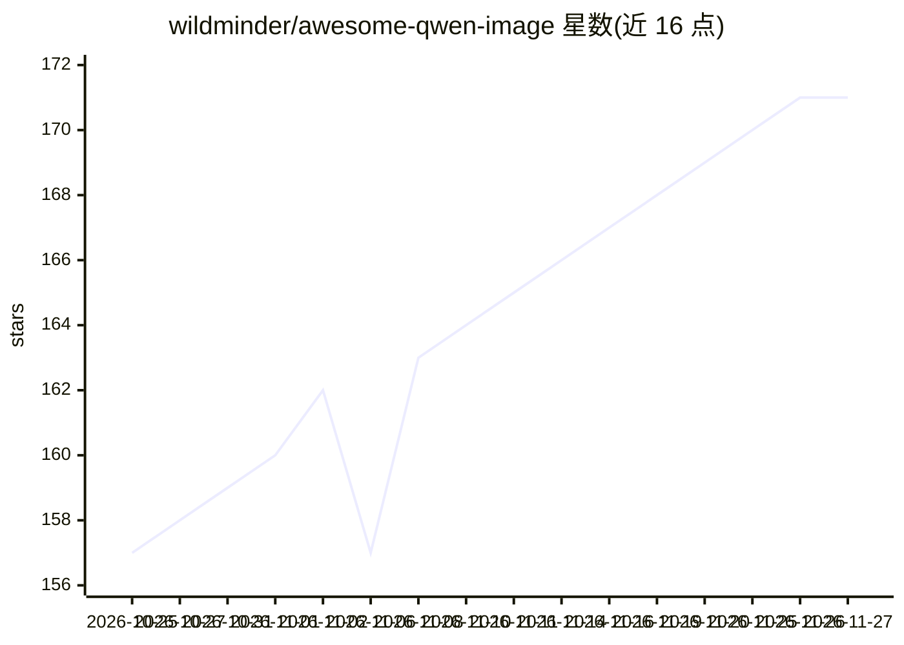

# wildminder/awesome-qwen-image

⭐ 171 · 推送 2026-11-13 · [GitHub](https://github.com/wildminder/awesome-qwen-image) · 个人维护 · 中文 README

**Qwen-Image 2.1 模型资源清单：权重、量化、LoRA 与工具索引**

围绕阿里 Qwen-Image 2.1（7B 统一文生图与图像编辑模型）的策展清单，按使用入口组织条目：Diffusers 参考权重、ComfyUI Day-0 原生节点包、低显存 int4 ConvRot 方案、GGUF 量化、官方与社区 Turbo 蒸馏版本、MLX 4-bit Mac 构建，以及 prompt 重写模型（PE-T2I/PE-I2I 及 Pocket 版）。还收录经 abliterated 处理的文本编码器与重写器变体，并附模型架构事实（RGBA 输出、最多 10 张参考图、Qwen3-VL-8B 文本编码器约 17.5 GB）。README 未给出本清单自身的安装命令。

## 筛选速览

| 维度 | 判定 | 备注 |
|---|---|---|
| AI 角色 | `ai-knowledge` | 知识聚合/清单类 |
| 许可风险 | `none` | — |
| 部署形态 | `None` |  |
| 模型依赖 | local-ok | 支持本地模型 |
| 硬件要求 | — | 无带数字的原话,不猜 |
| 安装摩擦 | `low` | 无编译、无系统依赖或容器化 |
| 成熟度 | — | 结构信号不足 |

## 能力要点

- 按运行时入口组织：Diffusers/ComfyUI/GGUF/MLX 各有对应条目
- 覆盖 bf16、int8 ConvRot、Q2_K–Q8_0 等多档量化权重
- 收录官方 prompt 重写模型与 0.8B/2B Pocket 缩减版
- 标注各文件的目标目录（models/diffusion_models 等）与加载方式

## 适用场景

- 为 ComfyUI 搭建 Qwen-Image 2.1 生图/修图工作流挑选权重
- 在 8–12 GB 显存或 Apple Silicon 上寻找可运行的量化版本
- 查找官方或社区的少步数 Turbo 加速 checkpoint 与 LoRA

## 场景标签

`精选清单` `图像生成` · 领域:内容生成

## 证据(README 行号)

> L1: # Awesome Qwen-Image 2.1
> L3: A curated list of checkpoints, quants, prompt engines, LoRAs, and tooling for **Qwen-Image 2.1**, Alibaba's 7B unifi
> L19: ## ⌬ Quick start

## 星数曲线

2026-10-25 157 → 2026-11-27 171（+14）

---
*卡片 v1 · prompt 1.4 · 生成 2026-11-26 · 置信度 high · 依据 README sha `f8a53f378a1a` · [字段定义](../../DATASET.md)*
