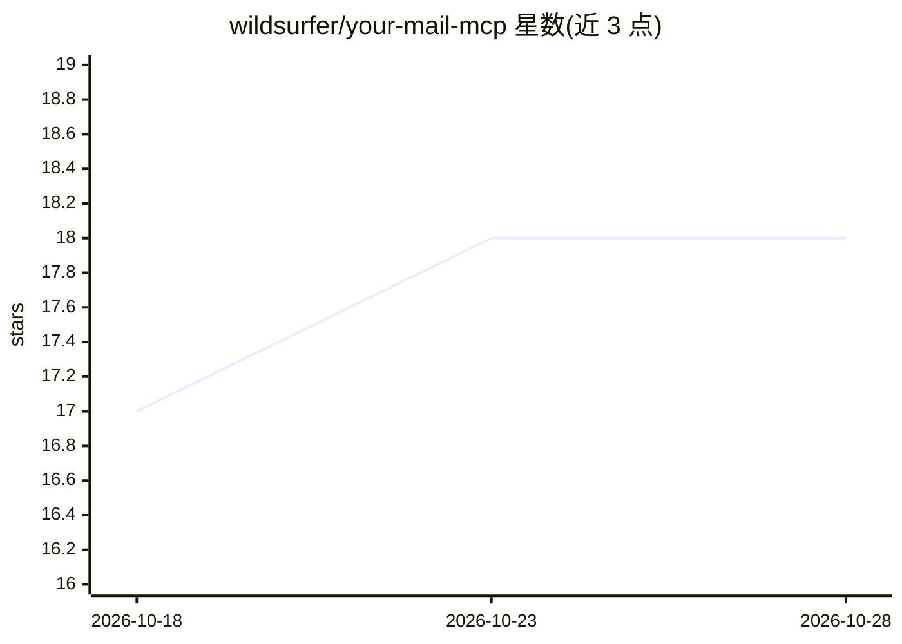

# wildsurfer/your-mail-mcp

⭐ 19 · Go · MIT · 推送 2026-10-27 · [GitHub](https://github.com/wildsurfer/your-mail-mcp) · [官网](https://github.com/wildsurfer/your-mail-mcp#readme) · 个人维护

**只读 MCP 服务器：把 IMAP 邮件镜像到本地并供 AI 助手检索**

自托管的 MCP 服务器，用 Go 编写、以 Docker 镜像分发：通过 mbsync 将一个或多个 IMAP 账户拉取到本地 maildir，用 notmuch 建立全文索引，向 MCP 客户端提供 11 个只读工具（搜索、读线程、取附件、同步状态等）。Claude/ChatGPT 手机应用经 HTTPS+OAuth 连接，Claude Code、Cursor、Codex 等经 stdio 连接。设计上无任何发送/删除/移动邮件的路径，镜像为 pull-only；大账户首同步受 Gmail 每日约 2.5GB 的 IMAP 下载上限限制。

## 筛选速览

| 维度 | 判定 | 备注 |
|---|---|---|
| AI 角色 | `ai-ecosystem` | LLM/agent 周边工具 |
| 许可风险 | `permissive` | MIT |
| 部署形态 | `self-host` | docker 或自建部署 |
| 模型依赖 | — | README 未给出锁定关系 |
| 硬件要求 | — | 无带数字的原话,不猜 |
| 安装摩擦 | `low` | 无编译、无系统依赖或容器化 |
| 成熟度 | — | 结构信号不足 |

## 能力要点

- mbsync 镜像 + notmuch 索引，多账户汇入单一索引
- 11 个只读工具，支持 notmuch 查询语法（from:/to:/date:/and/or/not）
- 进程无发送、删除或移动邮件的路径，镜像 pull-only
- 支持 Tailscale Funnel / Cloudflare Tunnel 暴露 HTTPS + OAuth 短语认证

## 适用场景

- 让 Claude/ChatGPT 等 AI 助手检索自己邮箱里的预订号、发票、承诺记录
- 每天早晨生成跨账户的邮件摘要，垃圾邮件已过滤
- 把邮件线程中的需求拉入编码或写作会话作为上下文
- 配合本地 LLM 的 MCP 客户端实现完全不离机的邮件问答

## 场景标签

`文档问答` · 领域:知识与检索

## 证据(README 行号)

> L36: A self-hosted MCP server. It mirrors one or more IMAP accounts into a local
> L39: The Claude and ChatGPT apps attach over HTTPS with OAuth; Claude Code, Codex,

## 星数曲线

2026-10-18 17 → 2026-10-28 18（+1）

---
*卡片 v1 · prompt 1.4 · 生成 2026-10-28 · 置信度 high · 依据 README sha `38b5e119f7a6` · [字段定义](../../DATASET.md)*
