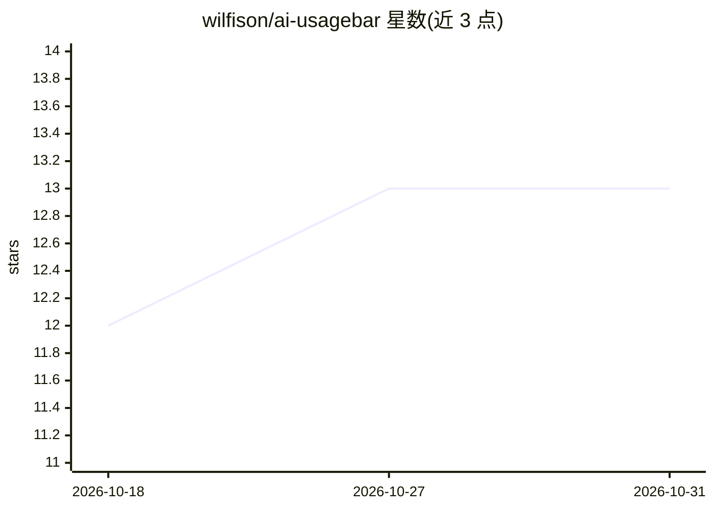

# wilfison/ai-usagebar

⭐ 13 · JavaScript · MIT · 推送 2026-10-02 · [GitHub](https://github.com/wilfison/ai-usagebar) · 个人维护

**GNOME Shell 扩展：顶栏实时显示各家 AI 订阅用量与重置倒计时**

面向 GNOME Shell 47–51 桌面用户的顶栏扩展：轮询 Anthropic (Claude)、OpenAI (Codex)、Z.AI/GLM、OpenRouter、DeepSeek、Kimi、Ollama Cloud 及自定义 JSON 端点，在顶栏显示紧凑用量标签（如 `42% · 3h12m`），点击弹窗分厂商展示会话/周用量、模型上限、银行化重置、余额与进度标记，支持滚动切换厂商与自定义 token 占位符模板。凭证本地读取、仅发往对应厂商，HTTPS 传输、无遥测。仅通过 GitHub Releases 分发，无构建步骤。

## 筛选速览

| 维度 | 判定 | 备注 |
|---|---|---|
| AI 角色 | `ai-ecosystem` | LLM/agent 周边工具 |
| 许可风险 | `permissive` | MIT |
| 部署形态 | `desktop` | 安装包/桌面程序 |
| 模型依赖 | local-ok | 支持本地模型 |
| 硬件要求 | — | 无带数字的原话,不猜 |
| 安装摩擦 | `low` | 无编译、无系统依赖或容器化 |
| 成熟度 | — | 结构信号不足 |

## 能力要点

- 8 类厂商（含自定义 JSON 端点映射）的用量、余额与重置倒计时监控
- 标签/弹窗支持 token 占位符模板与各厂商专属字段
- Claude Code 会话上下文占用监视（读取 ~/.claude/projects 转录尾部）
- 429 限流暂停、阈值通知、陈旧数据保留 7 天等行为策略

## 适用场景

- 订阅多个 AI 服务时在顶栏一眼看到剩余额度与重置时间
- 接近额度上限或银行化重置即将过期时收到通知
- 把自有服务的 JSON 接口映射成自定义用量面板

## 场景标签

 · 领域:桌面工具/AI 用量监控

## 证据(README 行号)

> L3: A GNOME Shell extension that shows your AI plan usage in the top panel for
> L18: |**Anthropic (Claude)**|Session + weekly usage, model-scoped caps, extra usage, banked resets, plan; optionally you

## 星数曲线

2026-10-18 12 → 2026-10-31 13（+1）

---
*卡片 v1 · prompt 1.4 · 生成 2026-10-31 · 置信度 high · 依据 README sha `ae71bbb6b071` · [字段定义](../../DATASET.md)*
