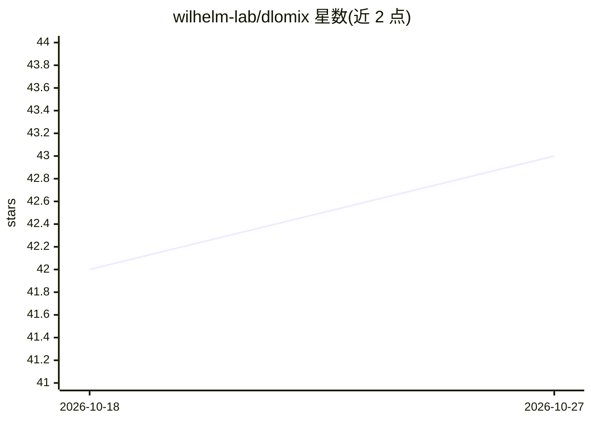

# wilhelm-lab/dlomix

⭐ 43 · Python · MIT · 推送 2026-10-07 · [GitHub](https://github.com/wilhelm-lab/dlomix) · [官网](https://dlomix.readthedocs.io/) · 组织维护

**蛋白质组学深度学习框架：多后端实现肽段预测模型**

面向蛋白质组学研究者的 Python 深度学习框架，提供 TensorFlow/Keras 与 PyTorch 双后端，通过 DLOMIX_BACKEND 环境变量切换，两后端 API 与功能保持一致且模型经核验计算同一函数。数据模块基于 HuggingFace datasets 构建，后端无关。内置 Prosit 保留时间/碎片离子强度预测、电荷态预测、肽段可检测性、DeepLC、Ionmob 等模型（PIMMS-CF 仅 PyTorch 实验性支持）。限制：需自行安装 TensorFlow 或 PyTorch；TensorFlow 后端要求 2.18+（Keras 3）。

## 筛选速览

| 维度 | 判定 | 备注 |
|---|---|---|
| AI 角色 | `ai-native` | 本体是模型或模型工具 |
| 许可风险 | `permissive` | MIT |
| 部署形态 | `library` | 以包/库形式分发 |
| 模型依赖 | — | README 未给出锁定关系 |
| 硬件要求 | — | 无带数字的原话,不猜 |
| 安装摩擦 | `medium` | 含编译或系统依赖之一 |
| 成熟度 | — | 结构信号不足 |

## 能力要点

- TensorFlow/Keras 与 PyTorch 双后端，统一 API，模型跨后端核验一致
- 内置 Prosit、DeepLC、Ionmob 等 7 类蛋白质组学预测模型
- 数据模块基于 HuggingFace datasets，后端无关
- NVIDIA GPU（tf-cuda extra、pip 安装 CUDA 库）与 Apple GPU（tensorflow-metal/MPS）支持，附跨平台性能说明

## 适用场景

- 预测肽段保留时间与碎片离子强度用于质谱数据分析
- 在自选的 TensorFlow 或 PyTorch 后端下训练蛋白质组学模型
- 肽段可检测性（Pfly）与碰撞截面积（IonMob）预测

## 场景标签

 · 领域:计算蛋白质组学/生物信息学

## 证据(README 行号)

> L7: **DLOmix** is a Python framework for Deep Learning in Proteomics. DLOmix provides multi-backend support for both **T
> L113: |`PrositRetentionTimePredictor` [1]|✅|✅|
> L123: - Retention Time Prediction:

## 星数曲线

2026-10-18 42 → 2026-10-27 43（+1）

---
*卡片 v1 · prompt 1.4 · 生成 2026-10-25 · 置信度 high · 依据 README sha `8c28cfc9fded` · [字段定义](../../DATASET.md)*
