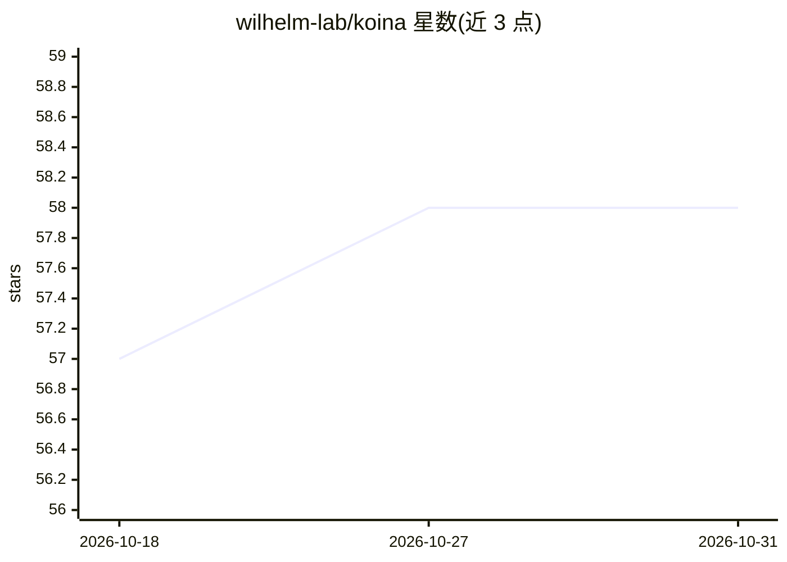

# wilhelm-lab/koina

⭐ 58 · Jupyter Notebook · Apache-2.0 · 推送 2026-10-27 · [GitHub](https://github.com/wilhelm-lab/koina) · [官网](https://koina.wilhelmlab.org/) · 组织维护

**蛋白质组学深度学习推理服务器：在线/自托管获取模型预测**

面向蛋白质组学的模型推理服务：以 HTTP API 方式提供 Prosit 等模型（如肽段碎片谱强度预测），输出 annotation、mz、intensities 等 JSON 结果。用户可访问公共服务器 koina.wilhelmlab.org，也可用 Docker 镜像自托管：依赖 docker 与 nvidia-container-toolkit，仅在带 Nvidia GPU 的 Linux（Debian/Ubuntu）上测试过，首次启动从 Zenodo 下载模型文件（约 10 分钟），支持多 GPU 选择，并可用 watchtower 自动更新；另提供 Ansible playbook 安装依赖。

## 筛选速览

| 维度 | 判定 | 备注 |
|---|---|---|
| AI 角色 | `ai-native` | 本体是模型或模型工具 |
| 许可风险 | `permissive` | Apache-2.0 |
| 部署形态 | `self-host` | docker 或自建部署 |
| 模型依赖 | — | README 未给出锁定关系 |
| 硬件要求 | — | 无带数字的原话,不猜 |
| 安装摩擦 | `low` | 无编译、无系统依赖或容器化 |
| 成熟度 | — | 结构信号不足 |

## 能力要点

- HTTP/gRPC 式 API 输出肽段谱预测（annotation/mz/intensities）
- 提供公共服务器，也支持 Docker 镜像自托管
- 支持多 GPU 选择与 watchtower 自动更新
- 提供 Ansible playbook 一键安装依赖

## 适用场景

- 通过公共 API 直接调用 Prosit 等蛋白质组学模型
- 实验室用自有 GPU 服务器自托管模型推理
- 在自动化质谱数据分析流水线中获取预测谱图

## 场景标签

 · 领域:生物信息学/蛋白质组学

## 证据(README 行号)

> L8: curl "https://koina.wilhelmlab.org/v2/models/Prosit_2019_intensity/infer" \
> L14: The output of an HTTP request is always a JSON object. The `outputs` key contains the outputs the model provides. I

## 星数曲线

2026-10-18 57 → 2026-10-31 58（+1）

---
*卡片 v1 · prompt 1.4 · 生成 2026-10-24 · 置信度 high · 依据 README sha `6a8b4a4697e9` · [字段定义](../../DATASET.md)*
