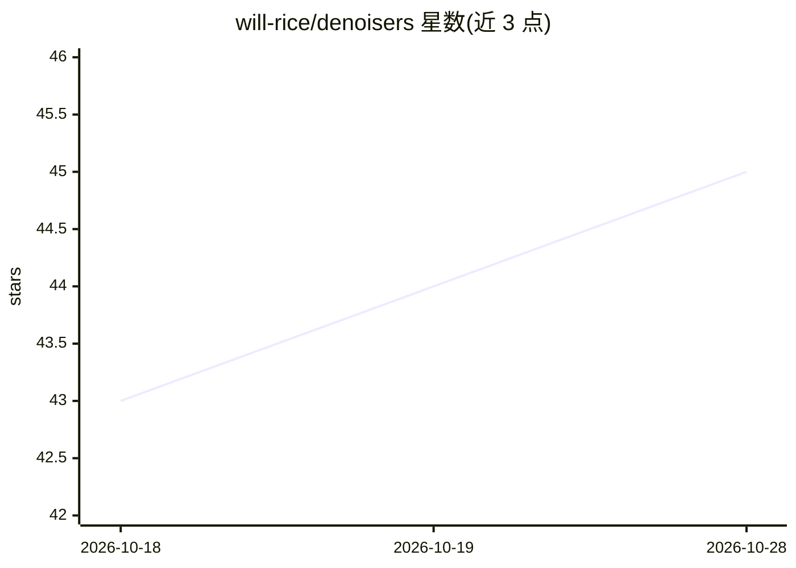

# will-rice/denoisers

⭐ 45 · Python · Apache-2.0 · 推送 2026-10-04 · [GitHub](https://github.com/will-rice/denoisers) · [官网](https://huggingface.co/spaces/wrice/denoisers) · 个人维护

**面向波形音频的 PyTorch 深度学习降噪库**

基于 PyTorch Lightning 的音频降噪 Python 库，提供 WaveUNet 与 UNet1D 两种网络架构，直接对 wav/flac/mp3/ogg 等波形文件执行去噪推理，并在 Hugging Face Hub 发布了 6 个预训练模型（覆盖语音与鸟鸣，24/48kHz 等采样率）。同时提供训练自定义模型的 CLI（支持多 GPU、EMA、混合精度、audiomentations 数据增强）、PESQ/STOI/DNS-MOS 等评估指标、Weights & Biases 实验跟踪与一键发布到 Hugging Face Hub。要求 Python 3.9+，Apache 2.0 许可。

## 筛选速览

| 维度 | 判定 | 备注 |
|---|---|---|
| AI 角色 | `ai-native` | 本体是模型或模型工具 |
| 许可风险 | `permissive` | Apache-2.0 |
| 部署形态 | `library` | 以包/库形式分发 |
| 模型依赖 | — | README 未给出锁定关系 |
| 硬件要求 | — | 无带数字的原话,不猜 |
| 安装摩擦 | `medium` | 含编译或系统依赖之一 |
| 成熟度 | — | 结构信号不足 |

## 能力要点

- WaveUNet 与 UNet1D 两种降噪架构，UNet1D 面向实时处理场景
- Hugging Face Hub 提供 6 个预训练模型（含多采样率与鸟鸣降噪）
- CLI 训练自定义模型，支持多 GPU、EMA、混合精度与数据增强
- 内置 PESQ/STOI/DNS-MOS 等音频质量评估指标

## 适用场景

- 用预训练模型对语音录音做降噪处理
- 用自己的音频数据训练定制降噪模型并发布到 Hugging Face
- 为语音增强或鸟鸣分析任务评估模型质量

## 场景标签

`模型训练` · 领域:训练与推理

## 证据(README 行号)

> L8: Denoisers is a comprehensive deep learning library for audio denoising with a focus on simplicity, flexibility, and 
> L39: ```python

## 星数曲线



2026-10-18 43 → 2026-10-28 45（+2）


---
*卡片 v1 · prompt 1.4 · 生成 2026-10-25 · 置信度 high · 依据 README sha `c9637d14fd39` · [字段定义](../../DATASET.md)*
