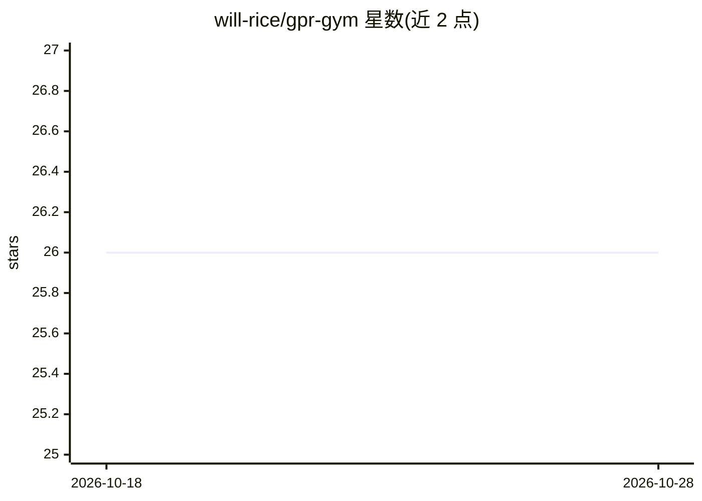

# will-rice/gpr-gym

⭐ 26 · Jupyter Notebook · Apache-2.0 · 推送 2026-10-04 · [GitHub](https://github.com/will-rice/gpr-gym) · 个人维护

**用 gprMax 批量生成探地雷达 B-scan 训练数据的示例工程**

面向探地雷达（GPR）机器学习研究的示例仓库：通过 gprMax 仿真批量生成 B-scan 训练样例，用于缓解大规模训练数据生成困难的问题（作者在硕士论文中遇到的 hurdles）。安装需 git clone --recursive 后进入 gprMax 子模块执行 setup.py build/install，再 pip 安装依赖，随后运行 generate_training_data.py 产出数据。作者声明 config 较粗糙，定位为入门起点而非成品工具，并请求引用其论文。

## 筛选速览

| 维度 | 判定 | 备注 |
|---|---|---|
| AI 角色 | `ai-ecosystem` | LLM/agent 周边工具 |
| 许可风险 | `permissive` | Apache-2.0 |
| 部署形态 | `library` | 以包/库形式分发 |
| 模型依赖 | — | README 未给出锁定关系 |
| 硬件要求 | — | 无带数字的原话,不猜 |
| 安装摩擦 | `low` | 无编译、无系统依赖或容器化 |
| 成熟度 | `idea` | |

## 能力要点

- 基于 gprMax 仿真批量生成 B-scan 训练数据
- 以递归克隆方式捆绑 gprMax 子模块并本地构建
- 提供单一脚本 generate_training_data.py 生成数据

## 适用场景

- 为 GPR 机器学习模型准备仿真训练集
- 参考其流程搭建自己的 gprMax 数据生成管线

## 场景标签

`教程课程` · 领域:学习与行业

## 证据(README 行号)

> L5: This repo is an example of how one can generate many training examples with gprMax
> L6:  for use with machine learning models.

## 星数曲线

2026-10-18 26 → 2026-10-28 26（+0）

---
*卡片 v1 · prompt 1.4 · 生成 2026-10-26 · 置信度 mid · 依据 README sha `ddaee40b9e59` · [字段定义](../../DATASET.md)*
