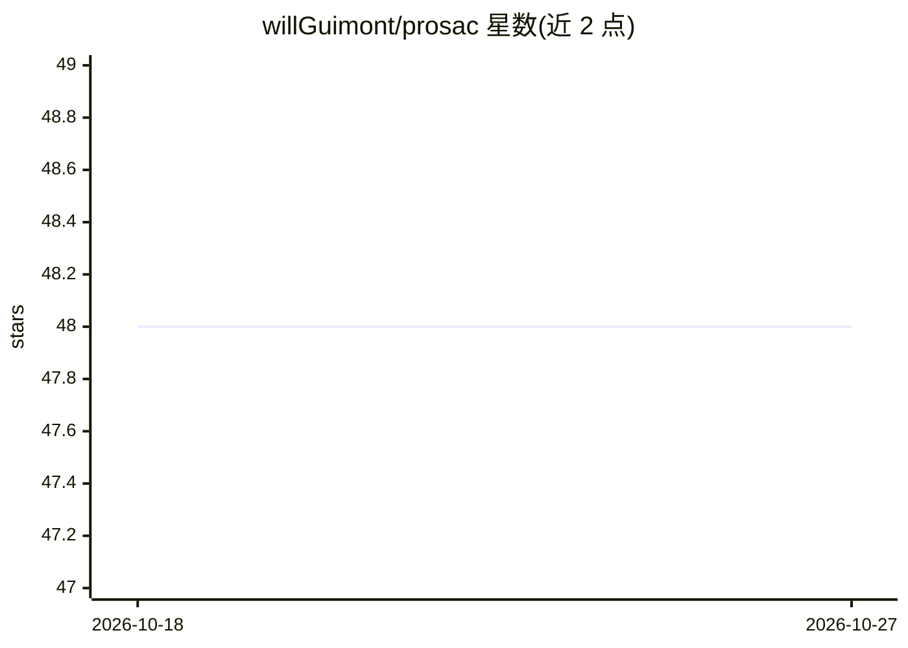

# willGuimont/prosac

⭐ 48 · Python · MIT · 推送 2026-09-25 · [GitHub](https://github.com/willGuimont/prosac) · 个人维护

**提供 RANSAC 与 PROSAC 鲁棒估计算法的 Python 库**

Python 包，实现 RANSAC 与 PROSAC 两种基于随机抽样的鲁棒模型估计算法，实现参考自 prosac.c。PROSAC 在抽样中利用数据点质量排序以更快找到内点（算法说明见作者博客与 PROSAC 论文）。通过 pip 以 prosac 包名安装，也可经 git+https 从源码安装到 requirements.txt，用法示例见仓库 examples 目录。适用于需要从含噪声数据中拟合模型的开发者。

## 筛选速览

| 维度 | 判定 | 备注 |
|---|---|---|
| AI 角色 | `ai-native` | 本体是模型或模型工具 |
| 许可风险 | `permissive` | MIT |
| 部署形态 | `library` | 以包/库形式分发 |
| 模型依赖 | — | README 未给出锁定关系 |
| 硬件要求 | — | 无带数字的原话,不猜 |
| 安装摩擦 | `low` | 无编译、无系统依赖或容器化 |
| 成熟度 | — | 结构信号不足 |

## 能力要点

- 实现 RANSAC 与 PROSAC 两种鲁棒估计算法
- 实现参考 C 语言版本 prosac.c
- 提供 examples 目录展示用法

## 适用场景

- 从含离群点的数据中拟合几何或统计模型
- 在特征匹配后做单应/基础矩阵等鲁棒估计
- 比较 PROSAC 与普通 RANSAC 的抽样效率

## 场景标签

 · 领域:机器学习/计算机视觉算法库

## 证据(README 行号)

> L3: This package provides an implementation of the RANSAC and PROSAC algorithms in Python.
> L6: Explanation of the PROSAC algorithm can be found

## 星数曲线

2026-10-18 48 → 2026-10-27 48（+0）

---
*卡片 v1 · prompt 1.4 · 生成 2026-10-25 · 置信度 high · 依据 README sha `5171cd5cd225` · [字段定义](../../DATASET.md)*
