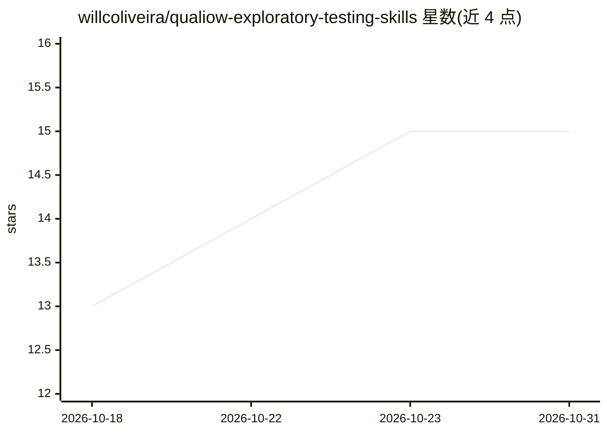

# willcoliveira/qualiow-exploratory-testing-skills

⭐ 15 · TypeScript · MIT · 推送 2026-10-29 · [GitHub](https://github.com/willcoliveira/qualiow-exploratory-testing-skills) · [官网](https://www.npmjs.com/package/qualiow-exploratory-testing) · 个人维护

**给 QA 工程师的 Claude Code 探索性测试技能包**

以 Claude Code 技能（slash 命令）、子代理与 QA 知识库组成的探索性测试工具包，覆盖 Web（playwright-cli）、移动端（Maestro shim）与后端/API（git show、只读 aws-cli、认证 fetch）三类对象。Claude 扮演 Principal QA Engineer：先理解业务、按风险排序、系统化探索并输出面向管理层的缺陷报告；CLI 负责项目初始化、配置校验、会话收尾与报告导出（md/html/json/jira）。判断类结论（严重级/优先级/是否为缺陷）不委托给子代理；提供三种安装路径：npm、Claude Code 插件市场与 git checkout。

## 筛选速览

| 维度 | 判定 | 备注 |
|---|---|---|
| AI 角色 | `ai-ecosystem` | LLM/agent 周边工具 |
| 许可风险 | `permissive` | MIT |
| 部署形态 | `library` | 以包/库形式分发 |
| 模型依赖 | locked-api |  |
| 硬件要求 | — | 无带数字的原话,不猜 |
| 安装摩擦 | `medium` | 含编译或系统依赖之一 |
| 成熟度 | — | 结构信号不足 |

## 能力要点

- 11 个技能与 5 个子代理，覆盖 Web/移动/后端三类探索性测试
- qualiow CLI 承担固定契约工作：init、validate、session finalize、报告导出（md/html/json/jira）
- 缺陷判定由 qa-bug-judge（opus）独立复核，输出 CONFIRMED/REFUTED 等裁决
- npm / Claude Code 插件市场 / git checkout 三种安装路径

## 适用场景

- 让 Claude Code 对 Web 应用做无脚本的探索性测试并产出缺陷报告
- 对移动原生应用或模拟器中的页面执行探索性测试
- 针对验收标准做无 UI 的后端/API 验证（表、流、队列、IAM、HTTP 端点）

## 场景标签

`浏览器自动化` `GUI 自动化` · 领域:效率与自动化

## 证据(README 行号)

> L3: AI-powered exploratory testing for **web**, **mobile** and **backend/API** — Claude Code skills, a QA knowledge base
> L18: - **Claude Code** — the skills run as slash commands inside it
> L105: listing, report export. **The exploratory sessions themselves run inside Claude Code**, not

## 星数曲线

2026-10-18 13 → 2026-10-31 15（+2）

---
*卡片 v1 · prompt 1.4 · 生成 2026-10-30 · 置信度 high · 依据 README sha `f341e76a8c05` · [字段定义](../../DATASET.md)*
