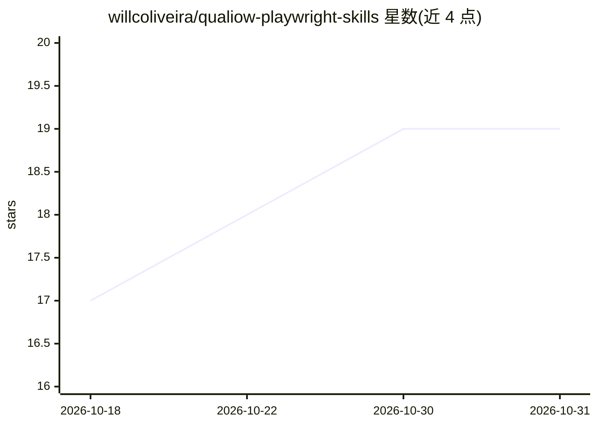

# willcoliveira/qualiow-playwright-skills

⭐ 19 · TypeScript · MIT · 推送 2026-10-29 · [GitHub](https://github.com/willcoliveira/qualiow-playwright-skills) · [官网](https://www.npmjs.com/package/wico-playwright-agent-skills) · 个人维护

**为 AI 编码助手生成 Playwright E2E 测试技能的脚手架 CLI**

一个 Node.js CLI（npx wico-playwright-agent-skills init），把一份策划好的 Playwright E2E 测试知识技能按 Agent Skills 规范生成到 Claude Code、Cursor、GitHub Copilot 及通用 .agents/skills/ 平台的项目中。技能内容覆盖操作流程、定位器与断言、fixture 与认证、CI 与 flake 排查、agent 调试等参考文档，另有模板包、六个工作流命令、四个 Claude Code 子代理包。CLI 检测已装的 Playwright 版本并生成对应内容的文件。

## 筛选速览

| 维度 | 判定 | 备注 |
|---|---|---|
| AI 角色 | `ai-ecosystem` | LLM/agent 周边工具 |
| 许可风险 | `permissive` | MIT |
| 部署形态 | `library` | 以包/库形式分发 |
| 模型依赖 | — | README 未给出锁定关系 |
| 硬件要求 | — | 无带数字的原话,不猜 |
| 安装摩擦 | `low` | 无编译、无系统依赖或容器化 |
| 成熟度 | — | 结构信号不足 |

## 能力要点

- 一条命令为多平台生成 playwright-e2e 技能（SKILL.md + 参考文档）
- 技能内容覆盖定位器断言、fixture 认证、CI/flake 排查、agent 调试等 11 类参考
- workflows 包提供 6 个工作流命令与 4 个 Claude Code 子代理
- 按已安装 Playwright 版本生成 1.59 前后不同的参考内容

## 适用场景

- 给 Claude Code/Cursor/Copilot 安装 Playwright 测试技能，免去每次口头教 assistant
- 在 CI 中用非交互参数批量生成技能文件
- 让 agent 按统一流程规划、生成、审查和调试 E2E 测试

## 场景标签

`代码生成` · 领域:编码与开发

## 证据(README 行号)

> L3: Reusable Playwright E2E testing knowledge for AI coding assistants, installed as a standard Agent Skill. One command
> L27: npx wico-playwright-agent-skills init

## 星数曲线

2026-10-18 17 → 2026-10-31 19（+2）

---
*卡片 v1 · prompt 1.4 · 生成 2026-10-29 · 置信度 high · 依据 README sha `6a2a0bcac266` · [字段定义](../../DATASET.md)*
