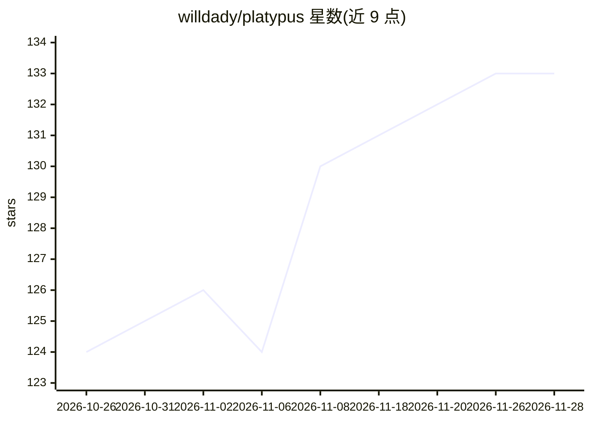

# willdady/platypus

⭐ 133 · TypeScript · MIT · 推送 2026-11-27 · [GitHub](https://github.com/willdady/platypus) · [官网](https://platypus.chat) · 组织维护

**给团队在自有基础设施上自托管全天候运行的多租户 AI Agent 平台**

开源全栈 AI Agent 平台：用户自带模型（托管、代理或本地硬件），平台提供 Agent 编排（模型、指令、工具、可复用 Skills、子 Agent）、MCP 数据源连接、A2A 协议对外暴露端点、隔离沙箱、记忆提取注入、看板、Artifacts、定时/事件触发器和 Webhook 通知。按组织/工作区做多租户隔离，Blueprint 可一步搭建新团队工作区。MIT 许可，通过 Docker Compose 脚本一键部署，需 Linux/macOS（Windows 用 WSL）加 Docker；无 SSO/OIDC/SAML，登录为邮箱密码。

## 筛选速览

| 维度 | 判定 | 备注 |
|---|---|---|
| AI 角色 | `ai-ecosystem` | LLM/agent 周边工具 |
| 许可风险 | `permissive` | MIT |
| 部署形态 | `self-host` | docker 或自建部署 |
| 模型依赖 | local-ok | 支持本地模型 |
| 硬件要求 | — | 无带数字的原话,不猜 |
| 安装摩擦 | `low` | 无编译、无系统依赖或容器化 |
| 成熟度 | — | 结构信号不足 |

## 能力要点

- Agent 定义一次，含模型/指令/工具/Skills/子 Agent，按需委托
- 触发器按 cron、一次性或工作区事件在服务端持续运行 Agent
- MCP 与 A2A 协议支持，插件 SDK 可扩展工具/沙箱/搜索后端
- Provider 无关：OpenAI、Anthropic、Google、Bedrock、OpenRouter 及 Ollama/vLLM/OpenAI 兼容端点

## 适用场景

- 团队在内部基础设施上部署 AI Agent，数据不出内网
- 让 Agent 定时或按看板事件自动执行任务并产出通知/Webhook
- 为外部 Agent 或聊天平台通过 A2A 协议开放自有 Agent

## 场景标签

`多智能体` `Agent 框架` · 领域:Agent 开发

## 证据(README 行号)

> L13: Platypus is an open-source, full-stack application for building AI Agents that reason, use tools, and keep working 
> L42: - **🌐 Provider Agnostic:** Powered by the Vercel AI SDK — OpenAI, Anthropic, Google, Bedrock, and OpenRouter, plus 

## 星数曲线

2026-10-26 124 → 2026-11-28 133（+9）

---
*卡片 v1 · prompt 1.4 · 生成 2026-11-28 · 置信度 high · 依据 README sha `2487bebec7bc` · [字段定义](../../DATASET.md)*
